<!-- Deck-local styling. The diagrams are standalone SVGs in assets/diagrams/
     (each carries its own styles and fonts); this only lays them out. -->

# Before we start

<!-- _class: build -->

- This session is about the **model**: what the system does, and the words we use for it
- **We want to get everyone on the same page:** Forget DIRAC concepts!
- **Implementation and scalability:** not today
    - Write them down, ask us over coffee ☕
- It's all in the ADRs: [diracx#1042](https://github.com/DIRACGrid/diracx/pull/1042)
    - DX-ADR-002 → 009, plus an [explanation](https://diracx--1042.org.readthedocs.build/en/1042/user/explanations/transformation-system/) and a [playground](https://diracx--1042.org.readthedocs.build/en/1042/playground/) you can poke at

---

<!-- _class: section -->

# What this is not

---

<!-- _class: build -->

# What this is not

- **Not** the DIRAC Transformation System with a new coat of paint
    - Same underpinnings and lessons learned, but a different shape
    - One system where DIRAC had three:
      - Transformation
      - Production
      - "job" half of the WMS
- **Not** only for centrally ran activity
    - "User jobs" change too

---

# DIRAC's WMS is two distinct abstractions

- **Pilots:** getting hold of resources
- **Jobs:** describing the work to run on them
- DiracX pulls them apart:
    - Pilots → **Compute Backends**
    - Jobs → **Transformation System**


---

# Same concept, new names

> jobs, transformation and productions are the same <cite>The future of DIRAC</cite>

- We meant that about search APIs. Turns out it goes deeper:


---

# Grid high-throughput batch

- One program, thousands of files (or seeds), a `for` loop of submissions…
    - …then babysitting: resubmit failures, group small files, track what's done
- This is the problem we're trying to solve


---

<!-- _class: build pair -->

# Two minimal use cases

<!-- step -->

Generic data processing: process + merge


<!-- step -->

Generic simulation: produce + process + merge


---

<!-- _class: section -->

# What is it?

---

# What is it?

<blockquote class="defn">

A **workgraph** is a directed acyclic graph of **transformations**. It is what DIRAC called a production. Each transformation maintains a pool of **inputs**: a **feeder** tops up the pool from the experiment's metadata catalogue, a **packer** groups pooled inputs into **parcels**, and a **dispatcher** hands each parcel to a compute or data **backend**, which executes it as a job or a request. A workgraph is written as a **CWL document**: its dataflow declares how transformations chain, and inputs arriving from outside the workgraph carry the metadata queries that tell the feeder what to fetch.

<cite>DX-ADR-002</cite>
</blockquote>

---

# Workgraph

> **A workgraph**

- The **entire thing**: everything needed to deliver what was asked for
    - What DIRAC called a **production**
- Created in one go, with all its transformations
- Its **status is constrained** by its members', provides **control flow**
    - start, scout, drain, halt, cancel

---

# Workgraph



---

# Directed acyclic graph

> A workgraph is a **directed acyclic graph**

- Transformations **chain**: the output of one is the input of the next
- A **graph**, not a chain: real workgraphs fork and merge
- Downstream picks up outputs **as they appear**
    - No waiting for the whole upstream stage to finish

---

# Directed acyclic graph



---

# Transformation

> A workgraph is a directed acyclic graph of **transformations**.

- Applies **one operation** to a pool of inputs
    - An [embarrassingly parallel](https://en.wikipedia.org/wiki/Embarrassingly_parallel) problem
- Two kinds:
    - **Compute:** runs jobs
    - **Data:** runs requests (copy or remove replicas)
- Same name and same idea as in DIRAC

---

# Transformation



---

# Inputs

> Each transformation maintains a pool of **inputs**

- Usually a file (LFN)
    - Sometimes a fraction of one, sometimes not a file at all (a seed)
- Processed **exactly once, or not at all**
    - `Unassigned` → `Assigned` → `Processed`
    - `Unassigned` → `Assigned` → `NotProcessed`

---

# Inputs



---

# Feeding

> …a **feeder** tops up the pool from the experiment's metadata catalogue

- **External** feeders bring work in from outside the workgraph
    - a metadata query, a run range that grows over time, seeds
    - Experiment-specific: this is where your catalogue plugs in
- **Internal** feeders follow the edges of the graph: you don't need to care

---

# Feeding



---

# Packing and parcels

> …a **packer** groups pooled inputs into **parcels**

- **When:** hold out for full groups while input keeps coming, pack the rest once it stops
- **How:** ~3 GB per parcel, same storage, same run, …
- A parcel is **never retried**: a failure sends its *inputs* back to the pool

---

# Packing and parcels



---

# Dispatching

> …and a **dispatcher** hands each parcel to a compute or data **backend**, which executes it as a job or a request

- Compute: native pilots, push to HPC, HTCondor, legacy DIRAC, …
- **Very flexible:** the dispatcher chooses, the packer can constrain
- User jobs take exactly the same path
- **Dedicated session tomorrow**

---

# Dispatching



---

# Written down as CWL

> A workgraph is written as a **CWL document**: its dataflow declares how transformations chain, and inputs arriving from outside the workgraph carry the metadata queries that tell the feeder what to fetch

- The **same document** regardless of local tests, user parcels or workgraphs
- Specified in [DX-ADR-007](https://github.com/DIRACGrid/diracx/pull/1042) - Ryun will cover this next

---

# Workgraph state machine (idealised)

<!-- The scout further arrow can go from both here and the next slide -->


---

# Hooks and actions

- In several places you have a limited set of hooks **OR** actions to drive the workgraph forward:
  - **Hooks** run while in a state and return changes to feeder arguments, pause, retry an input
  - **Actions** are ordered lists of steps, each recording `Passed`, `Failed` or `Pending`


---

<!-- _class: section -->

# Does it do everything we need?

---

# Composing the pieces

- Everything so far **composes**: any number of transformations, any shape of graph
- **Everybody (VOs, or even within a VO) has slightly different needs**
- Each use case changes only:
    - the shape of the graph
    - which feeder, packer, hooks and actions are plugged in
- Next: the two generic graphs again, with the additions in pink

---

<!-- _class: build -->

# Many outputs

- One step, several outputs
- A consumer consumes one output


<!-- step -->

---

<!-- _class: build -->

# Forking outputs

- One output, **many consumers**
- One input per consumer
  - Each input is processed once
- Each consumer tracks it's own progress


<!-- step -->

---

<!-- _class: build -->

# Removing replicas after N uses

- A **removal** transformation
  - fed by the same output
- Its packer delays each file until **all N consumers** have processed it


<!-- step -->

---

<!-- _class: build -->

# Correlated processing (external)

- An file  has to be processed with its **ancestor**
- The inputs holds only one of the datasets
    - The **packer** looks up each ancestor and adds it to the parcel


<!-- step -->

---

<!-- _class: build -->

# Correlated processing (internal)

- The same shape, inside one workgraph
- <strong class="tc-p2">Process 2</strong> needs both:
  - <strong class="tc-p1">Process 1</strong> output
  - <strong class="tc-gen">Generate</strong> output
- Its pool is fed by <strong class="tc-p1">Process 1</strong>
    - The **packer** adds the matching <strong class="tc-gen">Generate</strong> file to the **parcel**


<!-- step -->

---

<!-- _class: build -->

# Staging input

- Raw data lives on **tape**
- A **data transformation** stages it
    - Shares the processing step's query
- **Packer delays** each file until on buffer
    - The input just waits in the pool
    - Same mechanism can be used for site downtime, waiting calibrations, etc.


<!-- step -->

---

<!-- _class: build -->

# Single outputs

- **Example:** Every job also writes small files e.g. monitoring histograms
- Declare a **second output** of the step
- Two options:
    - **transformation** fed by that output,
      its packer waits for feeder to finish
    - **finalizing action** runs in DiracX tasks
- Not mutually exclusive


<!-- step -->

---

<!-- _class: build -->

# Keeping intermediate files

- Intermediate outputs are **transient**
- Want to keep one?
  **Declare it as an output** of the workgraph


<!-- step -->

---

# Retrying

- A parcel is **never** retried, its **inputs** are
- A **hook** decides each failed input's fate:
    - back to `Unassigned`, and repacked (maybe differently)
    - or `Problematic`, for an operator
- Still processed exactly once, or not at all


---

# Splitting

- A job processed **part** of its input
- Input status is `Split`, two inputs added
    - a `Processed` child
    - an `Unassigned` child
- `Unassigned` child could also be directly marked `Problematic` or `NotProcessed`


---

<!-- _class: build -->

# Scouting

- Run on a **small sample** first for
    - Resource estimation
    - Reliability / success rate
- **Not for testing if the workgraph works!**

 

- A **hook** decides when the scout is done
- Approved → the feeder's limits are lifted
    - Nothing the scout produced is redone
- Not convinced? **Scout further**


<!-- step -->

---

<!-- _class: build -->

# Resource estimation

- Just an **approving action**
- Measures CPU, memory, disk, ...
- Writes the needs back into each transformation's **requirements**
- Too high? The action fails, a human looks
- **Hooks** can also provide realtime feedback


<!-- step -->

---

<!-- _class: build -->

# Manual approval(s)

- Actions can manual sign-off steps, e.g.
    - Resource usage higher than expected?
    - Validate scouting results
    - Operations


<!-- step -->

---

# …and what did we miss?

- Have a use case that **doesn't** fit? We want to hear about it this week
- Bring it to the **CWL hackathon**

---

<!-- _class: section -->

# Future plans

---

<!-- _class: build -->

# Future plans

- **Operations / transformation debugging**
    - Why is this input `Problematic`? Where did this file come from?
- **Monitoring**
    - Exact counters per state, and a log of every transition
- **Analysis-productions-style submission**
    - Declarative, CI-driven, tested before it's submitted
- **Deploying software**

---

<!-- _class: section -->

# Questions?
