<style>
/* Deck-local: the ChatGPT screenshots are tall; keep each card inside the slide */
section.build.card .reveal-card figure { margin: 0; }
section.build.card .reveal-card figure img { max-height: 540px; max-width: 1140px; width: auto; display: block; margin: 0 auto; }
section.build.card .reveal-card:has(figure) { width: auto; padding: var(--sp-4); }
section.build.card .reveal-card img[src*="github-contributions"],
section.build.card .reveal-card img[src*="diracx-diagram"] { max-height: 440px; }

/* Deck-local: the timeline is long, tighten it a little */
section.timeline { --fs-body: 26px; --fs-body-sm: 23px; }
section.timeline ul ul > li { margin-top: 0.1em; margin-bottom: 0.1em; }

/* Deck-local: a row of DALL·E images with captions */
section .gallery { display: flex; gap: var(--sp-3); justify-content: center; align-items: flex-start; margin-top: var(--sp-4); }
section .gallery > div { width: 200px; text-align: center; }
section .gallery img { width: 200px; height: 200px; display: block; border-radius: 6px; }
section .gallery p { font-size: 17px; line-height: 1.25; margin: 0.4em 0 0; font-style: italic; }
section .gallery .gap { width: 2px; align-self: stretch; background: currentColor; opacity: 0.25; }

/* Deck-local: harness diagrams (16:9 inline SVG) */
section svg.hd { display: block; width: auto; height: 500px; max-width: 100%; margin: 0 auto; }
section.build.card .reveal-card:has(svg.hd) { width: 1200px; max-width: none; padding: var(--sp-3); }
section.build.card .reveal-card svg.hd { width: 100%; height: auto; max-height: 520px; }
section svg.hd text { font-family: var(--font-sans, inherit); }
section svg.ctx { display: block; width: 100%; margin-top: var(--sp-4); }
section .footnote code { font-size: 0.9em; }
</style>

<!-- _class: build -->

# Disclaimer

- This is a contentious and rapidly changing topic
    - There is no good or right answer
- This talk is heavily biased by how I work and the tools I've used
    - Mostly Claude Code, mostly with whatever the best model is that month
- I'm more interested in getting things done than playing with AI
- **Disclosure:** I currently get a free Claude subscription via Anthropic's open source program

---

<!-- _class: build card -->

# Who am I?

- Joined LHCb in 2014, physics PhD awarded in 2019, LHCb computing since 2019
- Split across Distributed Computing, DPA and Core Software
    - Occasional things in Simulation, RTA, ...
    - Also CVMFS infrastructure
- [conda-forge](https://conda-forge.org/) core team, lots of other open source contributions
- **In summary:** I jump around more than is average

<!-- step -->
<p class="step-title"><a href="https://github.com/chrisburr">@chrisburr on GitHub</a>: 31,265 contributions since 2013</p>
<figure>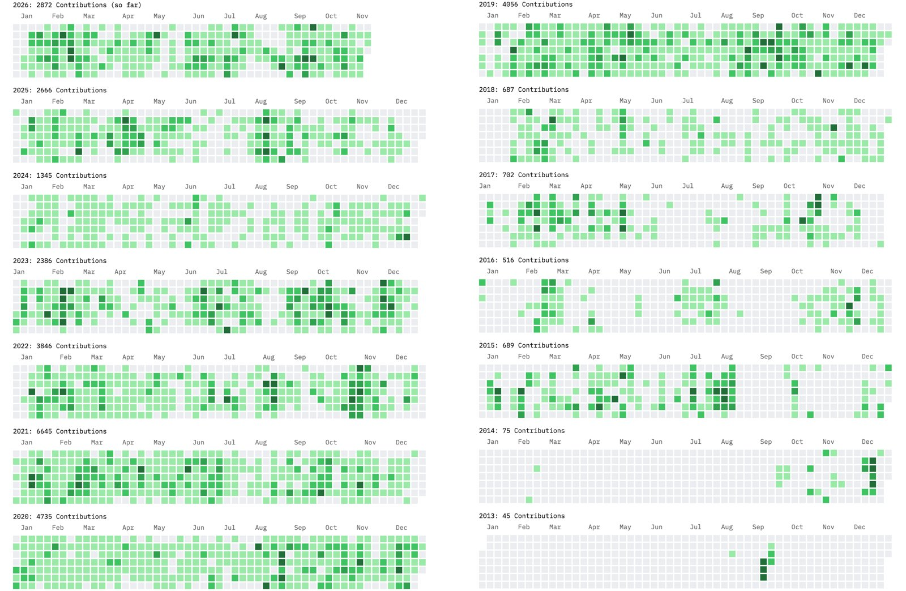</figure>

---

<!-- _class: section -->

# How did we get here?

---

# Spicy autocomplete

- **Jun 2021:** 📍 GitHub Copilot technical preview (I got in on 14 Jul)
- Tab-complete for the next few lines, guessed from the file you're in
- Used it a lot, but it didn't change *what* I asked a computer to do

<figure>
  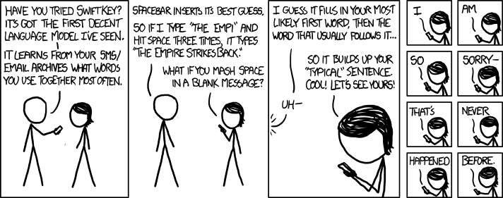
  <figcaption><a href="https://xkcd.com/1068/">xkcd 1068</a></figcaption>
</figure>

---

# An aside: images

- **Aug 2022:** 📍 into the DALL·E beta, 88 images in three days
- **Oct 2023:** brainstorming DiracX logos with DALL·E 3

<div class="gallery">
<div><p>"A cat cuddling an grumpy avocado…" (my first)</p></div>
<div><p>"Data police arresting big tech…"</p></div>
<div>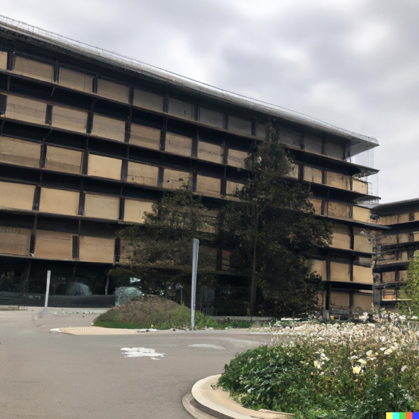<p>"A photo of a pretty CERN building" (it isn't)</p></div>
<div class="gap"></div>
<div>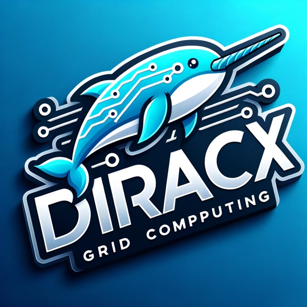<p>"…a logo featuring the word 'DiracX'…"</p></div>
<div>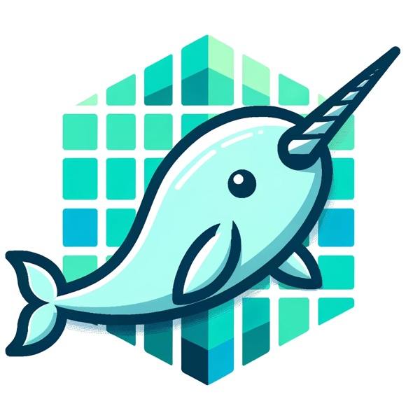<p>"…the 'X' integrated with a narwhal's tusk"</p></div>
</div>

---

<!-- _class: build card -->

# February 2023

- Debugging `voms-proxy-init` with OpenSSL 3 for (LHCb)DIRAC on conda-forge
    - Worked with OpenSSL 1.1.1, failed with 3.0
    - A proxy of a proxy gave `Error: verification failed.`
- Copied snippets into ChatGPT and asked questions

<!-- step -->

<figure>
  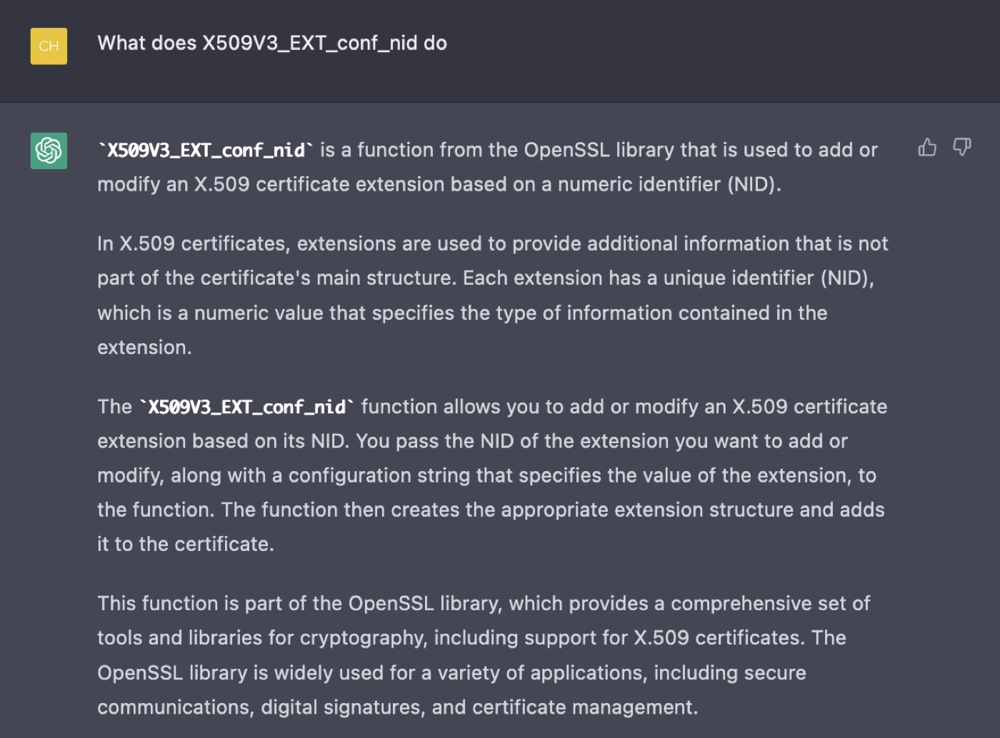
</figure>

<!-- step -->

<figure>
  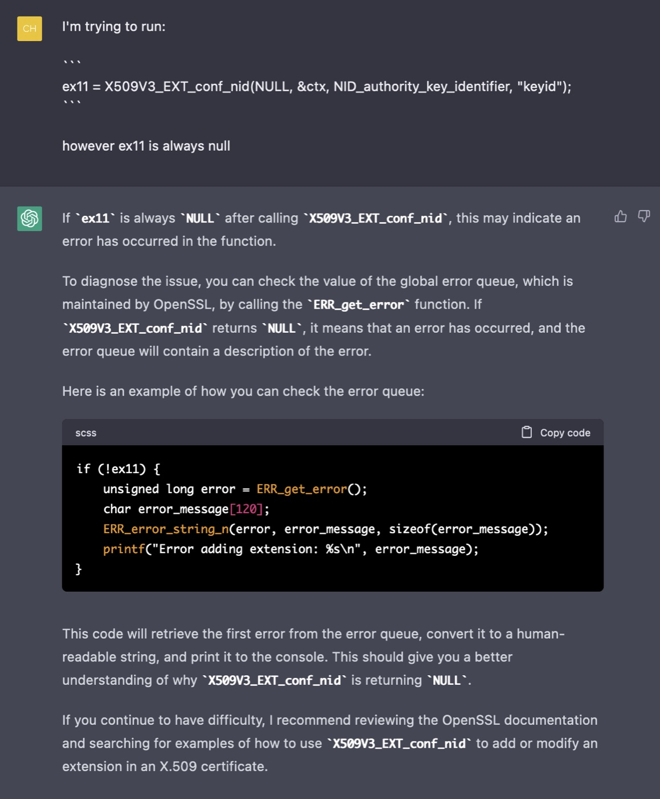
</figure>

<!-- step -->

<figure>
  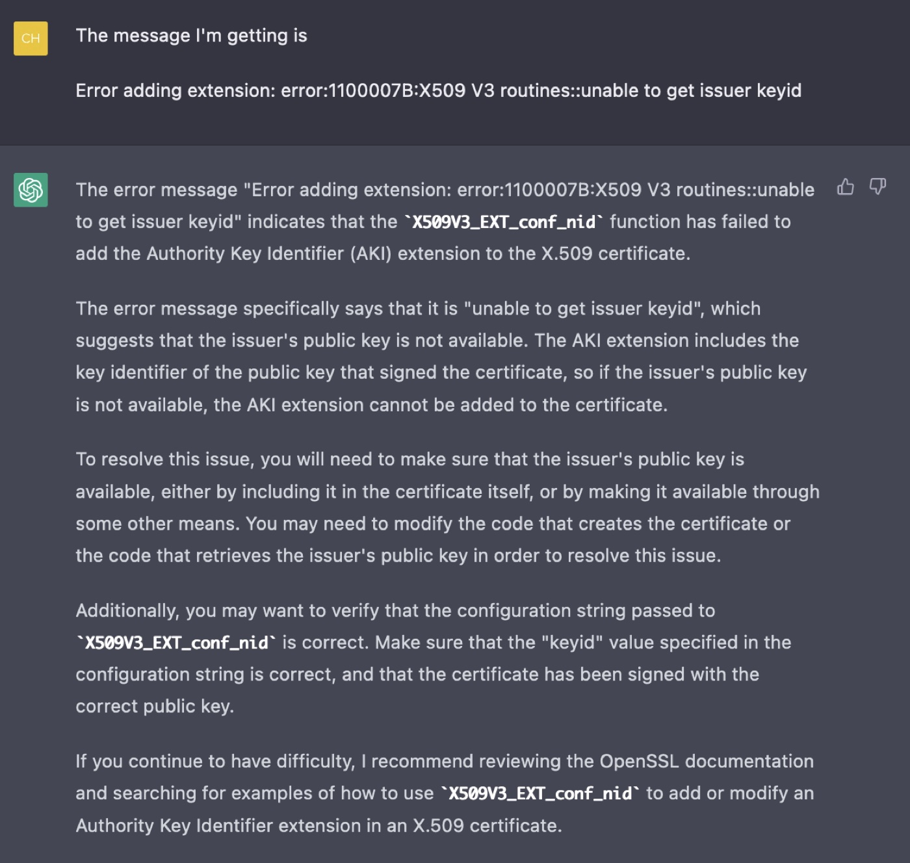
</figure>

---

# …which led to [voms#113](https://github.com/italiangrid/voms/pull/113)

- ChatGPT probably saved me a day of making sense of undocumented OpenSSL internals
- First time I had an LLM save a non-trivial amount of time on a real problem
- They were still deeply unreliable...

---

<!-- _class: build card -->

# The copy-paste era

<div class="cols">
<div>

- Paste code into a chat window, paste the answer back into your editor
- The model can't see your repository
- The model can't run anything
- Useful as a rubber duck that has read a lot of documentation

</div>
<div>

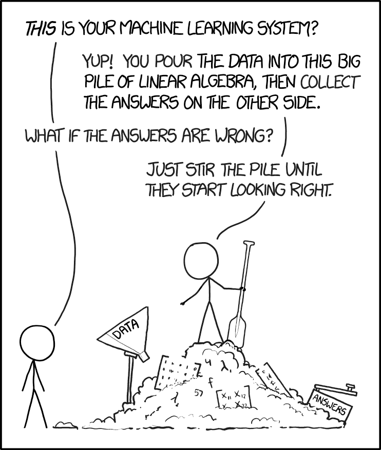

<p class="src"><a href="https://xkcd.com/1838/">xkcd 1838</a></p>

</div>
</div>

<!-- step -->

I still take this approach when interacting with things like databases

---

<!-- _class: section -->

# Coding harnesses

---

# From chat to harness

<svg class="hd" viewBox="90 35 860 475" role="img" aria-label="Left, 2023 chat: you copy commands from the chat window into your terminal and paste errors back. Right, harness: the harness does the shuttling and you only set the task and review">
<defs>
<marker id="ah" viewBox="0 0 10 10" refX="9" refY="5" markerWidth="7" markerHeight="7" orient="auto-start-reverse"><path d="M0 0 L10 5 L0 10 z" fill="#4A1789"/></marker>
<marker id="ah-muted" viewBox="0 0 10 10" refX="9" refY="5" markerWidth="7" markerHeight="7" orient="auto-start-reverse"><path d="M0 0 L10 5 L0 10 z" fill="#6C7280"/></marker>
<marker id="ah-green" viewBox="0 0 10 10" refX="9" refY="5" markerWidth="7" markerHeight="7" orient="auto-start-reverse"><path d="M0 0 L10 5 L0 10 z" fill="#1F9D55"/></marker>
</defs>
<line x1="480" y1="40" x2="480" y2="500" stroke="#E4E6EB" stroke-width="2"/>
<text x="240" y="62" text-anchor="middle" font-size="28" font-weight="700" fill="#4A1789">2023: chat</text>
<text x="720" y="62" text-anchor="middle" font-size="28" font-weight="700" fill="#4A1789">Now: harness</text>
<rect x="150" y="95" width="180" height="70" rx="12" fill="#4A1789"/><text x="240" y="138" text-anchor="middle" font-size="22" font-weight="700" fill="#fff">Chat window</text>
<rect x="150" y="375" width="180" height="70" rx="12" fill="#F4F1FA" stroke="#6A3FA8" stroke-width="2"/><text x="240" y="418" text-anchor="middle" font-size="22" font-weight="700" fill="#4A1789">Your terminal</text>
<circle cx="240" cy="270" r="48" fill="#fff" stroke="#D6332B" stroke-width="3"/><text x="240" y="277" text-anchor="middle" font-size="24" font-weight="700" fill="#D6332B">You</text>
<path d="M205 168 C 175 200, 180 230, 196 248" fill="none" stroke="#4A1789" stroke-width="2.5" marker-end="url(#ah)"/><text x="110" y="215" font-size="17" fill="#4A1789">copy</text>
<path d="M196 292 C 180 320, 180 350, 205 372" fill="none" stroke="#4A1789" stroke-width="2.5" marker-end="url(#ah)"/><text x="110" y="340" font-size="17" fill="#4A1789">paste</text>
<path d="M275 372 C 300 350, 300 320, 284 292" fill="none" stroke="#4A1789" stroke-width="2.5" marker-end="url(#ah)"/><text x="308" y="340" font-size="17" fill="#4A1789">copy error</text>
<path d="M284 248 C 300 230, 300 200, 275 168" fill="none" stroke="#4A1789" stroke-width="2.5" marker-end="url(#ah)"/><text x="308" y="215" font-size="17" fill="#4A1789">paste</text>
<text x="240" y="488" text-anchor="middle" font-size="20" fill="#D6332B" font-weight="700">You are the tool runner</text>
<rect x="630" y="95" width="180" height="70" rx="12" fill="#4A1789"/><text x="720" y="138" text-anchor="middle" font-size="22" font-weight="700" fill="#fff">Model</text>
<rect x="630" y="375" width="180" height="70" rx="12" fill="#F4F1FA" stroke="#6A3FA8" stroke-width="2"/><text x="720" y="418" text-anchor="middle" font-size="22" font-weight="700" fill="#4A1789">Your terminal</text>
<rect x="655" y="240" width="130" height="60" rx="12" fill="#fff" stroke="#4A1789" stroke-width="3"/><text x="720" y="277" text-anchor="middle" font-size="21" font-weight="700" fill="#4A1789">Harness</text>
<path d="M700 168 L700 236" stroke="#4A1789" stroke-width="2.5" marker-end="url(#ah)"/><path d="M740 236 L740 168" stroke="#4A1789" stroke-width="2.5" marker-end="url(#ah)"/>
<path d="M700 302 L700 371" stroke="#4A1789" stroke-width="2.5" marker-end="url(#ah)"/><path d="M740 371 L740 302" stroke="#4A1789" stroke-width="2.5" marker-end="url(#ah)"/>
<circle cx="890" cy="270" r="44" fill="#fff" stroke="#1F9D55" stroke-width="3"/><text x="890" y="277" text-anchor="middle" font-size="22" font-weight="700" fill="#1F9D55">You</text>
<path d="M846 255 L790 262" stroke="#1F9D55" stroke-width="2.5" marker-end="url(#ah-green)"/><text x="818" y="236" text-anchor="middle" font-size="16" fill="#1F9D55">task</text>
<path d="M790 286 L846 292" stroke="#1F9D55" stroke-width="2.5" stroke-dasharray="6 5" marker-end="url(#ah-green)"/><text x="818" y="318" text-anchor="middle" font-size="16" fill="#1F9D55">review</text>
<text x="720" y="488" text-anchor="middle" font-size="20" fill="#1F9D55" font-weight="700">You set the task and review the result</text>
</svg>

---

<!-- _class: build card -->

# What is a coding harness?

- A model, a loop and some tools:

```python
while not done:
    response = model(conversation)         # "think"
    for call in response.tool_calls:        # read / edit / run a command
        conversation += run(call)           # see what actually happened
```

- Tools are mundane: read a file, edit a file, search, run a shell command, ...
- **The key difference:** it sees the output of what it does
    - Compile errors, failing tests, `--help` output, ...
- Permissions decide which tool calls need your approval

<!-- step -->
<svg class="hd" viewBox="0 0 960 540" role="img" aria-label="You give a task to the harness; the harness sends the conversation to the model; the model replies with a tool call; the harness runs it on your repo and shell and sends the output back to the model; repeat until done, then the harness reports back to you">
<defs>
<marker id="ah" viewBox="0 0 10 10" refX="9" refY="5" markerWidth="7" markerHeight="7" orient="auto-start-reverse"><path d="M0 0 L10 5 L0 10 z" fill="#4A1789"/></marker>
<marker id="ah-muted" viewBox="0 0 10 10" refX="9" refY="5" markerWidth="7" markerHeight="7" orient="auto-start-reverse"><path d="M0 0 L10 5 L0 10 z" fill="#6C7280"/></marker>
<marker id="ah-green" viewBox="0 0 10 10" refX="9" refY="5" markerWidth="7" markerHeight="7" orient="auto-start-reverse"><path d="M0 0 L10 5 L0 10 z" fill="#1F9D55"/></marker>
</defs>
<rect x="370" y="40" width="220" height="100" rx="14" fill="#4A1789"/>
<text x="480" y="84" text-anchor="middle" font-size="32" font-weight="700" fill="#fff">Model</text>
<text x="480" y="116" text-anchor="middle" font-size="18" fill="#E9DFF7">decides the next step</text>
<rect x="370" y="300" width="220" height="120" rx="14" fill="#fff" stroke="#4A1789" stroke-width="3"/>
<text x="480" y="352" text-anchor="middle" font-size="30" font-weight="700" fill="#4A1789">Harness</text>
<text x="480" y="382" text-anchor="middle" font-size="17" fill="#6C7280">runs on your machine</text>
<rect x="40" y="315" width="160" height="90" rx="14" fill="#fff" stroke="#4A1789" stroke-width="3"/>
<text x="120" y="358" text-anchor="middle" font-size="30" font-weight="700" fill="#4A1789">You</text>
<text x="120" y="386" text-anchor="middle" font-size="17" fill="#6C7280">set the task</text>
<rect x="740" y="285" width="190" height="150" rx="14" fill="#F4F1FA" stroke="#6A3FA8" stroke-width="2" stroke-dasharray="6 5"/>
<text x="835" y="327" text-anchor="middle" font-size="24" font-weight="700" fill="#4A1789">The real world</text>
<text x="835" y="358" text-anchor="middle" font-size="17" fill="#6C7280">files · shell · tests</text>
<text x="835" y="382" text-anchor="middle" font-size="17" fill="#6C7280">git · CI · GitLab</text>
<text x="835" y="406" text-anchor="middle" font-size="17" fill="#6C7280">browser</text>
<path d="M202 342 L364 342" fill="none" stroke="#4A1789" stroke-width="3" marker-end="url(#ah)"/>
<text x="283" y="330" text-anchor="middle" font-size="18" fill="#4A1789">task</text>
<path d="M368 380 L206 380" fill="none" stroke="#6C7280" stroke-width="2.5" stroke-dasharray="7 6" marker-end="url(#ah-muted)"/>
<text x="283" y="408" text-anchor="middle" font-size="17" fill="#6C7280">"done" (or a question)</text>
<path d="M420 298 L420 146" fill="none" stroke="#4A1789" stroke-width="3" marker-end="url(#ah)"/>
<text x="408" y="215" text-anchor="end" font-size="18" fill="#4A1789">task + context</text>
<text x="408" y="238" text-anchor="end" font-size="18" fill="#4A1789">+ every result so far</text>
<path d="M540 142 L540 294" fill="none" stroke="#4A1789" stroke-width="3" marker-end="url(#ah)"/>
<text x="552" y="225" font-size="18" fill="#4A1789">tool call: "run pytest"</text>
<path d="M592 342 L734 342" fill="none" stroke="#6A3FA8" stroke-width="2.5" marker-end="url(#ah)"/>
<text x="663" y="330" text-anchor="middle" font-size="16" fill="#6A3FA8">runs it</text>
<path d="M738 380 L596 380" fill="none" stroke="#6A3FA8" stroke-width="2.5" marker-end="url(#ah)"/>
<text x="667" y="404" text-anchor="middle" font-size="16" fill="#6A3FA8">output</text>
<circle cx="480" cy="220" r="34" fill="#fff" stroke="#E4E6EB" stroke-width="2"/>
<text x="480" y="215" text-anchor="middle" font-size="16" fill="#4A1789" font-weight="700">repeat</text>
<text x="480" y="235" text-anchor="middle" font-size="15" fill="#6C7280">×100s</text>
<text x="480" y="490" text-anchor="middle" font-size="20" fill="#6C7280">You only talk to the harness. The model only ever sees text and</text>
<text x="480" y="516" text-anchor="middle" font-size="20" fill="#6C7280">never touches your machine: it asks, the harness does it.</text>
</svg>


---

# The options

- [Claude Code](https://code.claude.com/docs) — what I use (Anthropic)
- [Codex](https://github.com/openai/codex) (OpenAI)
- [Gemini CLI](https://github.com/google-gemini/gemini-cli) (Google)
- [Mistral Vibe](https://github.com/mistralai/mistral-vibe) (Mistral)
- [pi](https://github.com/badlogic/pi-mono), [OpenCode](https://opencode.ai) — independent, bring your own model
- IDE-integrated: Copilot, Cursor, JetBrains, ...
- They're converging: the model sets the ceiling, the harness decides how close you get

---

# Models

- Model quality continues to improve rapidly
- Benchmarks can be misleading
    - Models on "reasonable" hardware aren't comparable to even old cloud models
    - Missing the "depth" of knowledge
- Claude Opus/Sonnet 5.5 and GPT-6 Astra/GPT-6.1 Sol are unquestionably the best
    - Kimi K3.1 Pro, GLM-5.3 and DeepSeek-V4.1 are also very good
    - Effort levels aren't that useful to play with

---

<!-- _class: section -->

# Using a coding harness well

---

<!-- _class: build card -->

# What is the context window?

- Everything the model can see at once, measured in tokens (~¾ of a word)
    - Typically 200k–1M tokens: hundreds to thousands of pages
- The model has no memory: the harness resends all of it at every step
- When it's full, older parts get summarised ("compaction") and details get lost
- Quality drops before it's full: one task per session, keep `CLAUDE.md` short

<svg class="ctx" viewBox="0 0 1100 150" role="img" aria-label="A bar showing what fills the context window: system prompt and tools, CLAUDE.md and skills, your task, files it read, command output, its own replies, and the remaining free space">
<rect x="0" y="10" width="150" height="56" fill="#4A1789"/>
<rect x="150" y="10" width="90" height="56" fill="#6A3FA8"/>
<rect x="240" y="10" width="60" height="56" fill="#2D6CDF"/>
<rect x="300" y="10" width="260" height="56" fill="#B9A2E0"/>
<rect x="560" y="10" width="200" height="56" fill="#DCCFF0"/>
<rect x="760" y="10" width="100" height="56" fill="#EFE9F8"/>
<rect x="861" y="11" width="237" height="54" fill="#fff" stroke="#6C7280" stroke-width="2" stroke-dasharray="6 5"/>
<g font-size="19" text-anchor="middle" fill="#4A1789">
<text x="0" y="98" text-anchor="start">System prompt + tools</text>
<text x="195" y="132">CLAUDE.md, skills</text>
<text x="270" y="98">Your task</text>
<text x="430" y="132">Files it read</text>
<text x="660" y="98">Command output</text>
<text x="810" y="132">Its replies</text>
<text x="980" y="98" fill="#6C7280">Free (for now)</text>
</g>
</svg>

<div class="footnotes">
  <div class="footnote">Proportions illustrative</div>
</div>

<!-- step -->
<p class="step-title"><code>/context</code> in Claude Code, partway through writing this talk</p>
<figure>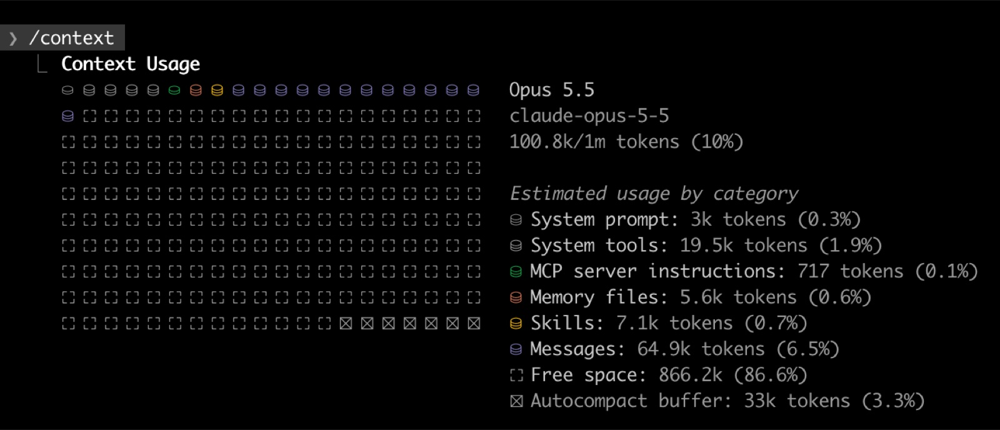</figure>

---

# Giving it context

<div class="cols" style="grid-template-columns: 2fr 1fr">
<div>

- `CLAUDE.md` / [`AGENTS.md`](https://agents.md): a README for the agent
    - How to buil/test, conventions, gotchas, preferences
    - Don't explain things they already know/can figure out
    - LLMs are good at writing these
- **Skills:** packaged instructions it loads when relevant
    - lhcb-development, conda-forge, charm-analysis, ...
- [`llms.txt`](https://llmstxt.org): documentation intended for models
    - could be useful for the nightlies (lighter than MCP)

</div>
<div>

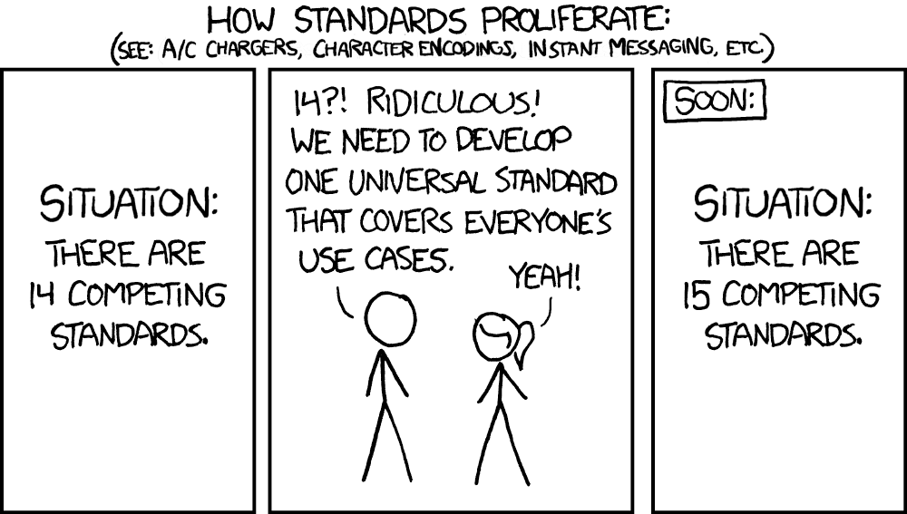

<p class="src"><a href="https://xkcd.com/927/">xkcd 927</a></p>

</div>
</div>

---

# Tools: the command line

- **CLI tools you already have:** `git`, `gh`, `glab`, `lb-run`, `pixi`, ...
    - Models are very good at shells, often better than bespoke integrations
- It uses them the same way you would:

```console
$ glab mr list --author=@me
$ glab mr checkout 1234
$ glab mr view 1234 --comments
```

---

# Tools: MCP servers

- [**MCP**](https://modelcontextprotocol.io) **servers:** plug in external services
    - Can be useful, but often not actually needed
- One standard that works across harnesses: Claude Code, Codex, Gemini CLI, ...
- If a decent CLI exists, that's usually the better option
- MCP can be useful for managing permissions/access control

---

# Tools: subagents

- **Subagents:** hand a sub-task to a fresh copy with its own context window
    - "Get a subagent to review this independently and report back"
    - Parallelise work, e.g. optimising different parts of a large codebase

---

# Tools: artifacts

- **Artifacts:** small web pages for reports, mockups and plots
    - My investigations end up as a page I can share, not a wall of text

<figure>
  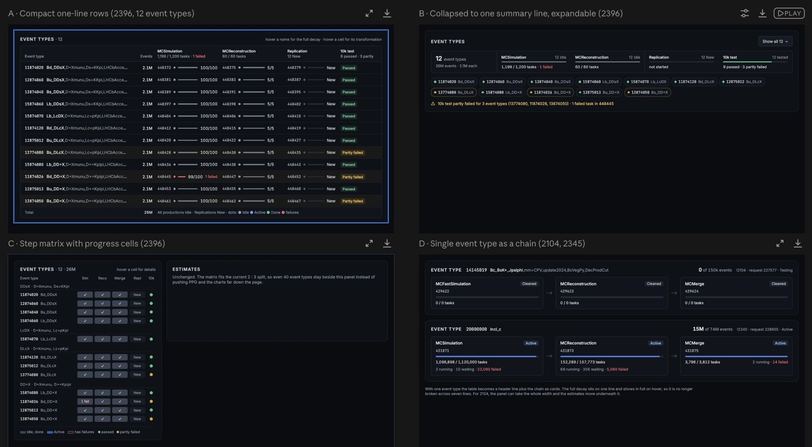
  <figcaption>Four mockups for one panel of a page about MC requests</figcaption>
</figure>

---

<!-- _class: build -->

# Letting it see what it builds

- Models are multimodal: screenshots, plots, PDFs, photos of a whiteboard
    - Especially important for web UI work, "it compiles" says nothing about how it looks
- Give it a browser: it can open the page, click around and take its own screenshots
    - Then fix what it sees, without me describing it
- **A useful pattern:** mock it up first, then implement against the mockup
    1. Ask for several mockups (A, B, C, ...) as throwaway web pages
    2. Pick one ("I like G, but with the header from C")
    3. Implement it, screenshot the result and compare it to the mockup

---

# Showing it what's wrong

<figure>
  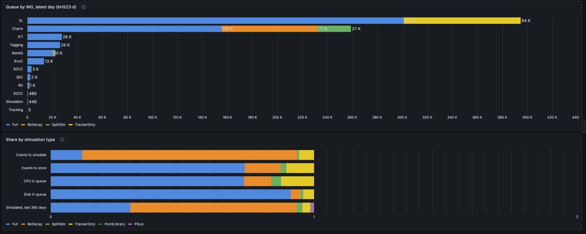
</figure>

> the white text on colours isn't readable and the share should be limited to 1

---

# Permissions and trust

<div class="cols" style="grid-template-columns: 2fr 1fr">
<div>

- Every tool call is a decision: ask you, allow, or deny
    - Approving every `ls` gets old very quickly
    - Accidentally doing `rm -rf $UNSET_VAR*` sucks...

- **Prompt injection:**
    - Anything it reads can contain instructions
    - Fundamentally impossible to avoid
    - Model resistance to prompt injection is independent of model ability

</div>
<div>

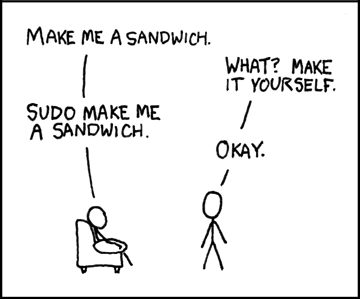

<p class="src"><a href="https://xkcd.com/149/">xkcd 149</a></p>

</div>
</div>

---

<!-- _class: build -->

# Sandboxing and prompt injection

- **Sandboxing:** limit what it *can* do, not just what it's *allowed* to do
    - Write access only to the project, network only to listed domains
    - Claude Code's [`/sandbox`](https://code.claude.com/docs/en/sandboxing), a devcontainer, a VM, ...
- Don't hand it credentials you wouldn't paste into a random web page
    - Grid proxies, GitLab tokens with write access, ...
    - Putting credentials in files is safer
- The systems we use need to catch up
    - A grid proxy can read and write all LHCb user data, and submit jobs
    - We want a convenient way to grant access to *just these files*
    - Analysis Productions can help here with the tooling that was built for GitLab CI

---

<!-- _class: build card -->

# Auto mode

- A classifier decides, you only get asked about the risky ones
    - **Mar 2026:** research preview in Claude Code, **Aug 2026:** the default
- Far fewer interruptions, so it can work for much longer without you
- Which is why the sandbox and the credentials you give it matter

<!-- step -->
<p class="step-title">It still asks about the risky ones, even while it's writing this talk</p>
<figure>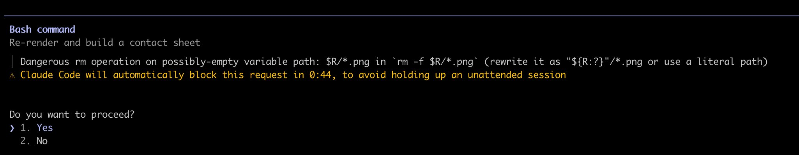</figure>

---

# How long can you look away?

<svg class="hd" viewBox="60 45 860 475" role="img" aria-label="A staircase from Tab completion (seconds) to chat (one answer) to a harness approving each command (minutes) to auto mode (an hour) to parallel background agents (overnight)">
<defs>
<marker id="ah" viewBox="0 0 10 10" refX="9" refY="5" markerWidth="7" markerHeight="7" orient="auto-start-reverse"><path d="M0 0 L10 5 L0 10 z" fill="#4A1789"/></marker>
<marker id="ah-muted" viewBox="0 0 10 10" refX="9" refY="5" markerWidth="7" markerHeight="7" orient="auto-start-reverse"><path d="M0 0 L10 5 L0 10 z" fill="#6C7280"/></marker>
<marker id="ah-green" viewBox="0 0 10 10" refX="9" refY="5" markerWidth="7" markerHeight="7" orient="auto-start-reverse"><path d="M0 0 L10 5 L0 10 z" fill="#1F9D55"/></marker>
</defs>
<line x1="70" y1="470" x2="910" y2="470" stroke="#6C7280" stroke-width="2" marker-end="url(#ah-muted)"/>
<text x="910" y="505" text-anchor="end" font-size="18" fill="#6C7280">more autonomy →</text>
<g font-size="19">
<rect x="80" y="400" width="150" height="70" fill="#EFE9F8"/>
<rect x="240" y="330" width="150" height="140" fill="#DCCFF0"/>
<rect x="400" y="255" width="150" height="215" fill="#B9A2E0"/>
<rect x="560" y="175" width="150" height="295" fill="#6A3FA8"/>
<rect x="720" y="90" width="150" height="380" fill="#4A1789"/>
<text x="155" y="380" text-anchor="middle" font-weight="700" fill="#4A1789">Tab</text><text x="155" y="440" text-anchor="middle" fill="#4A1789">seconds</text>
<text x="315" y="310" text-anchor="middle" font-weight="700" fill="#4A1789">Chat</text><text x="315" y="370" text-anchor="middle" fill="#4A1789">one answer</text>
<text x="475" y="235" text-anchor="middle" font-weight="700" fill="#4A1789">Harness</text><text x="475" y="295" text-anchor="middle" fill="#2A1450">approve each</text><text x="475" y="318" text-anchor="middle" fill="#2A1450">command</text><text x="475" y="350" text-anchor="middle" fill="#2A1450">minutes</text>
<text x="635" y="155" text-anchor="middle" font-weight="700" fill="#4A1789">Auto mode</text><text x="635" y="215" text-anchor="middle" fill="#fff">an hour</text>
<text x="795" y="70" text-anchor="middle" font-weight="700" fill="#4A1789">Many agents</text><text x="795" y="130" text-anchor="middle" fill="#fff">in parallel,</text><text x="795" y="153" text-anchor="middle" fill="#fff">overnight</text>
<g font-family="Fira Mono, monospace" font-size="17" fill="#6C7280">
<text x="155" y="462" text-anchor="middle" fill="#4A1789">2021</text><text x="315" y="462" text-anchor="middle" fill="#4A1789">2023</text><text x="475" y="462" text-anchor="middle" fill="#2A1450">2025</text><text x="635" y="462" text-anchor="middle" fill="#E9DFF7">2026</text><text x="795" y="462" text-anchor="middle" fill="#E9DFF7">2026</text>
</g>
</g>
</svg>

<div class="footnotes">
  <div class="footnote">Heights illustrative, not data</div>
</div>

---

<!-- _class: section -->

# What do I actually do with it?

---

# The last few weeks

- Across 7 machines (my laptop + LHCb build/dev nodes):
    - ~200 sessions, ~2,600 messages typed by me
    - ~40,000 tool calls, ~200 subagents
- **~257 merge/pull requests opened in ~25 repositories**
    - LbAPI, Rec, LHCb, LHCbDIRAC, DIRAC, Gaudi, puppet, conda-forge, ccache, ROOT, ...
- Plus many web chat sessions
- Much of this is "glue": reviews, rebases, CI fixes, backports

---

<!-- _class: build -->

# Changing what's possible

- Bit-for-bit reproducibility between ARM and x86 ([LHCb#455](https://gitlab.cern.ch/lhcb/LHCb/-/issues/455))
    - 67 → 199 of 204 Moore tests bit-identical
    - Six root causes: SIMD widths, NEON NaN handling, FMA contraction, ...
- Arthur's equivalent work for Allen/GPU code

    - [First support for AMD](https://gitlab.cern.ch/lhcb/Allen/-/merge_requests/2748) was done unsupervised in an hour or so
- Before agentic coding it wouldn't have been worth the time

---

# What it hands back

<figure>
  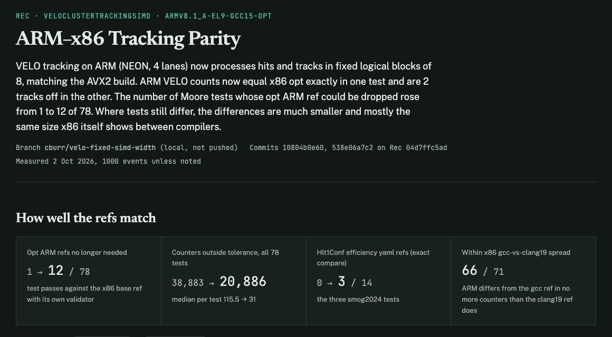
  <figcaption>One of the reports along the way to LHCb#455 (2 Oct, VELO tracking only)</figcaption>
</figure>

---

# Explore LHCb

- [`cburr/explore-lhcb`](https://gitlab.cern.ch/cburr/explore-lhcb): three.js + vanilla HTML/JS/CSS
    - Geometry from Phoenix, cavern from the CAD model, surface from maps.cern.ch
- 38 sessions, mostly "send a couple of messages, come back in an hour or two"
- **I typed ~10,000 words** (mostly bullet lists of LHCb facts from memory)
    - ~610 subagents, ~30,000 tool calls, ~4.8 million tokens generated
- I guided technical decisions only very broadly

---

<!-- _class: build card -->

# Designing the Simulation logo

- Silly idea, can I make a vaguely reasonable logo despite having no design skills?
1. A couple of first ideas - Gloria hated them 
1. "Generate 25 unique ideas based on first feedback"
1. Iterated a bit on my favourites
1. Built a website to easily switch typefaces and colours
1. Finished!

<!-- step -->
<figure>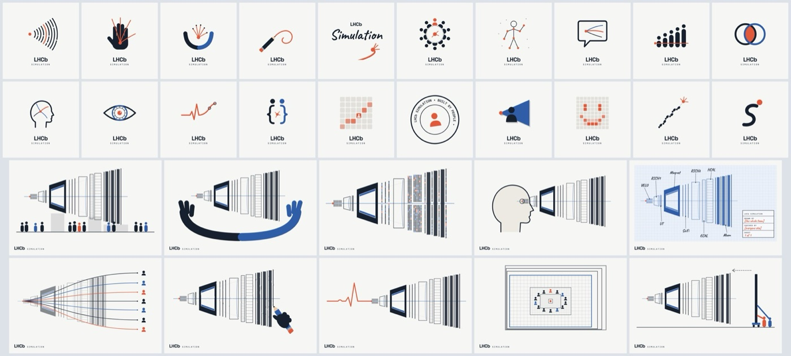</figure>

<!-- step -->
<figure>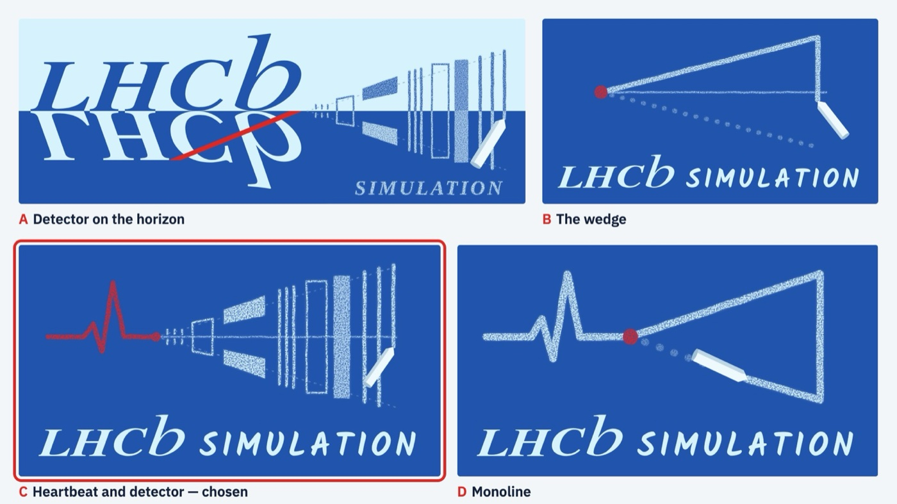</figure>

<!-- step -->
<figure>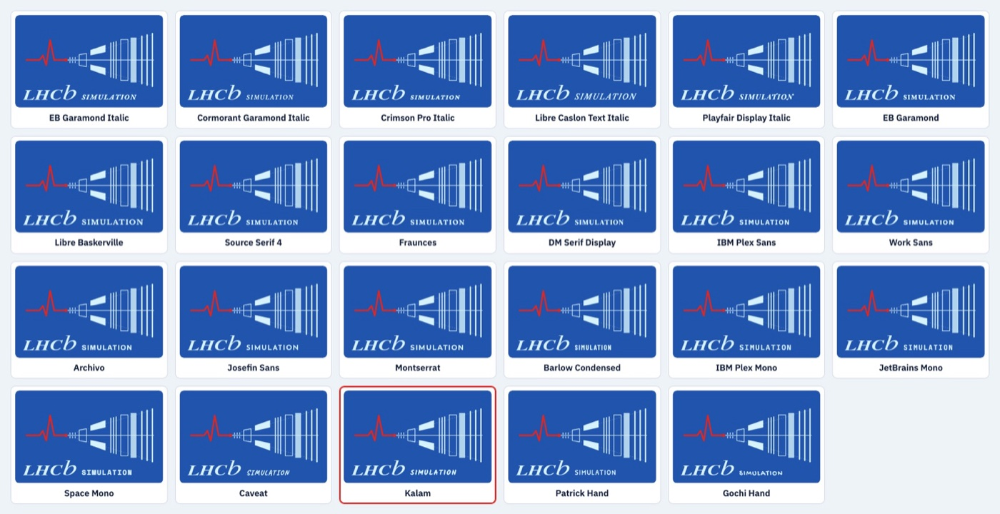</figure>

<!-- step -->
<figure>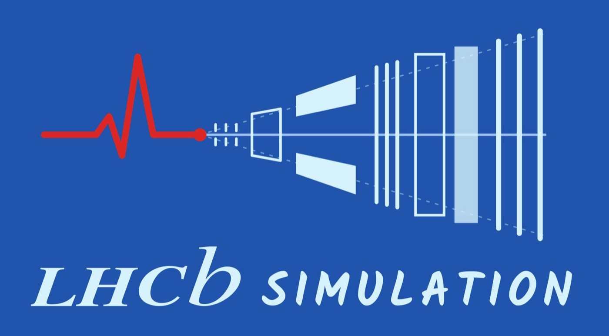</figure>

---

<!-- _class: section -->

# Writing

---

# Writing documentation

- Works very well, as long as you give it everything
    - The code, issues, old docs, your notes, chat logs, ...
    - Coding harnesses work well as they can access more webpages, clone repos, ...
- Point it at a structure such as [Diátaxis](https://diataxis.fr/)
    - Tutorials, how-to guides, reference and explanation are different documents
- Tell it who the audience is
    - A new PhD student and a core developer need very different docs
- Don't write docs for the sake of it
    - Or docs for LLMs about things they can figure out for themselves

---

<!-- _class: build card -->

# Writing slides

- Many years ago I gave up writing slides in Markdown/LaTeX - too tedious
- These slides are Markdown ([Marp](https://marp.app/)), so the agent can edit them directly
    - In ~30 minutes I built a tool to make slides the way I want to
- Regardless, LLMs are incredible at creating **diagrams**
    - Feed it massive amounts of context, generate many ideas then refine
    - **Be careful of "pretty but wrong"**
- A tendency to sensationalise and pad things out with fluff
    - Very different from the style we typically use in our community
- **tldr:** great for diagrams, but generally don't use LLMs for slides very much

<!-- step -->
<p class="step-title">From my <a href="https://indico.cern.ch/event/1668629/">DiracX production system</a> talk in July</p>
<figure>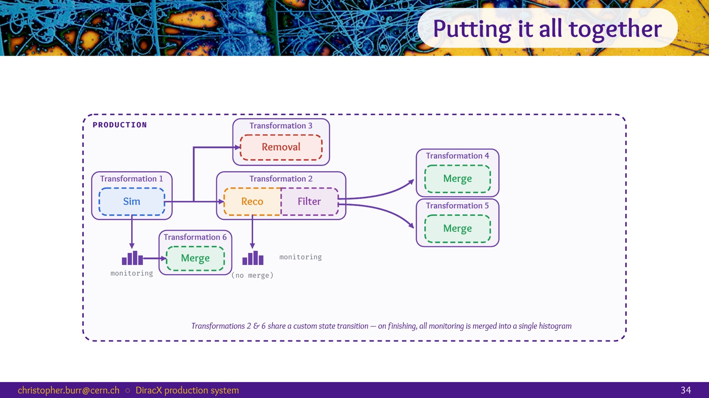</figure>

---

<!-- _class: section -->

# Responsibility and open questions

---

# You own what you commit

- It doesn't matter who (or what) wrote it, it's your name on the commit
- Read the diff like it came from an overconfident summer student
    - Tests that test nothing, swallowed exceptions, plausible-looking nonsense
- "The agent did it" is not an answer in a code review

<figure>
  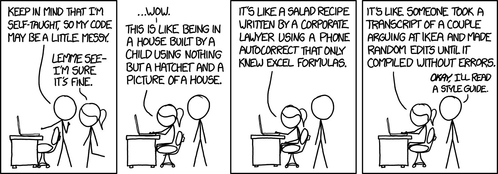
  <figcaption><a href="https://xkcd.com/1513/">xkcd 1513</a></figcaption>
</figure>

---

# The reviewer burden

- Writing code got a lot cheaper
- Reviewing code got easier, but not to the same degree
- What are you adding to the process?
    - A two-sentence prompt, an MR and expecting experts to review it is unfair
    - Is it faster for the experts to just use LLMs themselves?
    - Treat an LLM as an expert who can help/teach you
- More need to discuss beforehand
    - Prototyping is fine, faster than ever
    - It's fine to throw away prototypes that LLMs quickly made

---

# If you're starting out

- How do you build experience if you never have to struggle?
- [METR, early 2025](https://metr.org/blog/2025-07-10-early-2025-ai-experienced-os-dev-study/): experienced open source developers were ~19% **slower** with AI<sup>*</sup>
    - While believing they were ~20% faster
    - [Feb 2026 follow-up](https://metr.org/blog/2026-02-24-uplift-update/): probably faster now, but too many developers refused to work without AI to measure it
- **Novices:** [a widening gap](https://dl.acm.org/doi/10.1145/3632620.3671116) (ICER 2024, 21 students)
    - Students who already knew what to write got faster, the rest got an illusion of competence
    - [JetBrains Academy video](https://www.youtube.com/watch?v=HTUh0OO6Kmo): "anything you'd ask an AI to write, you should be able to write yourself"

<div class="footnotes">
  <div class="footnote">* A small study: 16 developers, 246 tasks</div>
</div>

---

# Personally

- I'm very glad I spent days and days debugging bizarre issues
    - And had a broad experience before any of this existed
- I haven't written code by hand in months<sup>*</sup>
- I've always liked using computers to *do things*
    - If you like writing the code itself, it's a harder transition
- I have no idea what the answer is here
    - Is it like long division, which nobody does by hand any more but is still worth learning?
    - Or like hand-loom weavers after the power loom, where the job just went away?

<div class="footnotes">
  <div class="footnote">* Not literally, but effectively true</div>
</div>

---

# The elephant in the room: paying for it

- My personal history:
    - **Apr 2023:** ~$20/month for ChatGPT Plus
    - **Jun 2025:** $20/month for Claude Pro
    - **Jan 2026:** $100/month for Claude Max
    - Currently: 6 months free via Anthropic's open source program
- You get what you pay for, free tiers are a poor way to judge it
- Not everyone can choose: CNRS staff only get [Emmy](https://emmy.cnrs.fr/) (Mistral Le Chat)<sup>*</sup>
    - No ChatGPT/Claude/Gemini, and no agentic coding tools (yet)

<div class="footnotes">
  <div class="footnote">* As of Feb 2026, <a href="https://cafe-info-apc.in2p3.fr/content/2026-02-emmy.html">APC café info</a></div>
</div>

---

# "Subscriptions are heavily subsidised"?

- **Spoiler:** serving the models looks profitable
    - Anthropic's IPO filing: ~85% gross margin in H1 2026<sup>*</sup> ([via Motley Fool](https://www.fool.com/investing/2026/10/31/anthropics-gross-margin-rocketed-to-85-from-12-in/))
    - Competition keeps prices in check, otherwise someone undercuts you<sup>†</sup>
- The money pit is training, not your tokens
    - Booked as R&D, outside that 85%
- **Unknown:** whether the heaviest flat-rate users cost more than they pay
    - Like a gym or "unlimited" mobile data: light users subsidise heavy ones

<div class="footnotes">
  <div class="footnote">* Excludes training. <a href="https://newsletter.semianalysis.com/p/anthropic-growth-and-bedrock-mix">SemiAnalysis estimate</a>: −94% (2024) → 38% (2025) → mid-60s% (Q1 2026)</div>
  <div class="footnote">† <a href="https://www.youtube.com/watch?v=xmkSf5IS-zw">Reiner Pope on Dwarkesh</a> (2 h, lots of details on how batching sets the price)</div>
</div>

---


# Running it yourself

- **On your desk:** [Qwen3.8-27B](https://huggingface.co/Qwen/Qwen3.8-27B)
    - ~18 GB at 4-bit: a 24 GB GPU or a 32 GB Mac
    - Impressive but still a long way behind
- **For a large group:** [Kimi K3](https://huggingface.co/moonshotai/Kimi-K3)-class models
    - 2.8T parameters (104B active), ~1.6 TB of weights, ~16 B200 GPUs
    - Close to frontier on agentic coding, but slower ([one independent test](https://www.superconductor.com/blog/kimi-k3-benchmark))
- **At scale:** Revolut moved ~2,000 engineers to self-hosted GLM ([AI Engineer talk](https://www.youtube.com/watch?v=Ok6QdZHCcI8))
    - 56 B200s, ~90% cheaper than Claude Code/Codex<sup>†</sup>
    - CERN IT is investigating various similar things
- Regardless of whether the AI bubble bursts, the models will still be economically viable

<div class="footnotes">
  <div class="footnote">† <a href="https://www.theregister.com/a/5307345">The Register</a></div>
</div>

---

<!-- _class: build timeline -->

# A rough timeline

- **Autocomplete and chat**
    - **Jun 2021:** 📍 GitHub Copilot preview (fancy autocomplete)
    - **Nov 2022:** [ChatGPT](https://chatgpt.com) is released
    - **Feb 2023:** 📍 First time I properly used an LLM for debugging

- **Coding harnesses**
    - **Nov 2024:** [Model Context Protocol](https://modelcontextprotocol.io) (MCP)
    - **Feb 2025:** [Claude Code](https://code.claude.com/docs) research preview
    - **Apr–Jun 2025:** [Codex CLI](https://github.com/openai/codex), [Gemini CLI](https://github.com/google-gemini/gemini-cli)
    - **Oct 2025:** Agent skills

- **Letting go of the steering wheel**
    - **Feb 2025:** `--dangerously-skip-permissions`, no prompts at all
    - **Mar 2026:** "Auto mode" in Claude Code (research preview)
    - **Aug 2026:** Auto mode becomes the default

--- 

<!-- _class: build -->

# Summary

- Models continue to improve at an incredible pace
    - Opus 5 -> Opus 5.5 was a massive jump
    - Who knows when they'll plateau? Feels like it can't be long
- The general model of agentic development feels like it's converged
    - Probably nothing particularly new coming... but maybe I'll be very wrong
- Choosing a harness, setup and tooling is a very personal decision
    - No sense in a universal setup, like the shared Emacs/Eclipse templates tried long ago
    - It'd be nice to have a one-size-fits-all answer, like VS Code becoming the de facto editor
- But paying for the tokens is still very much work-in-progress

---

<!-- _class: section -->

# Questions?
