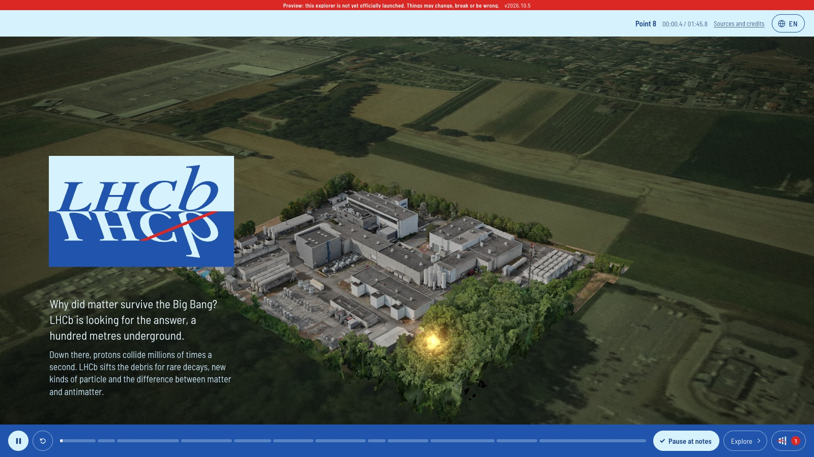
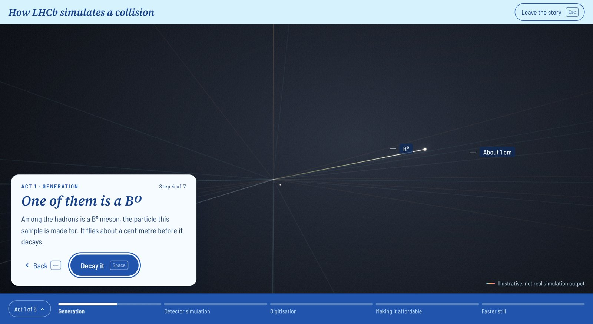
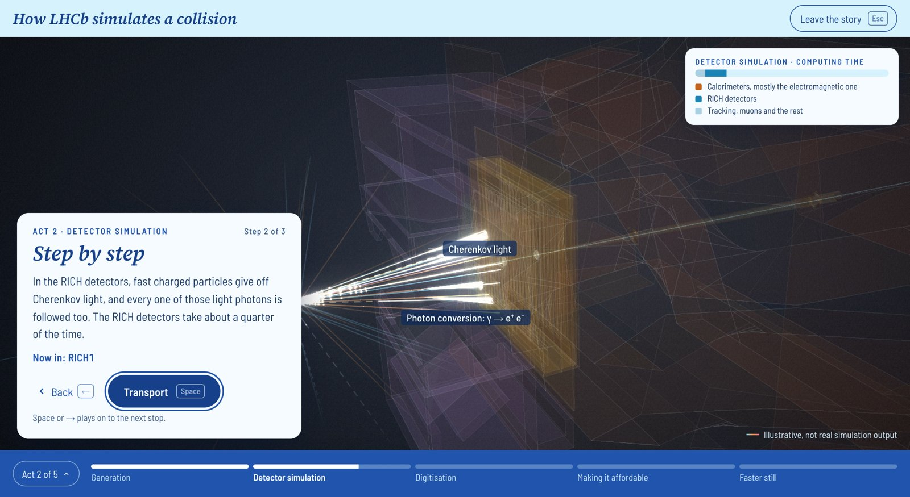
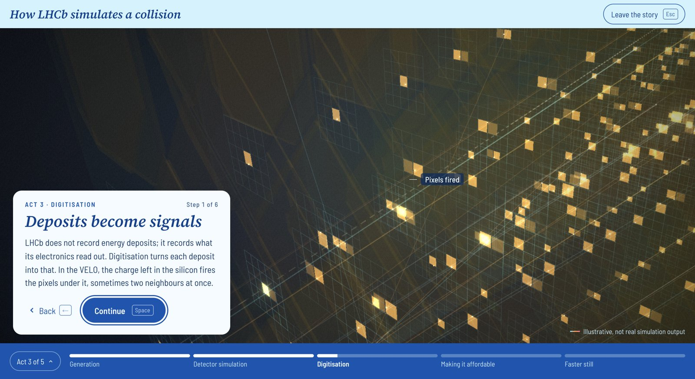
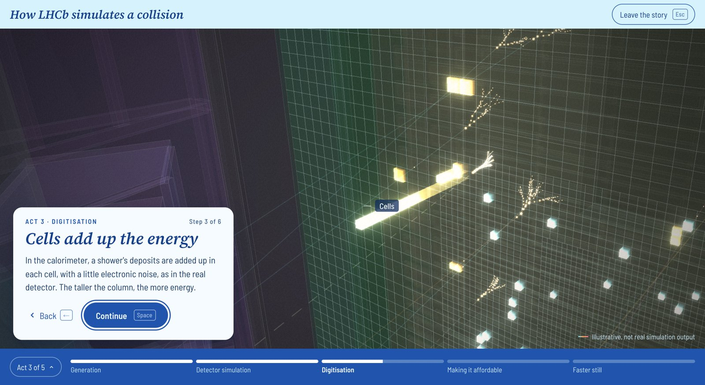
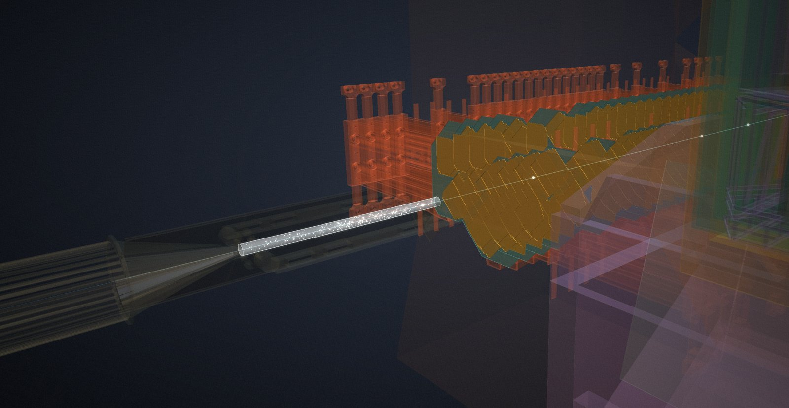
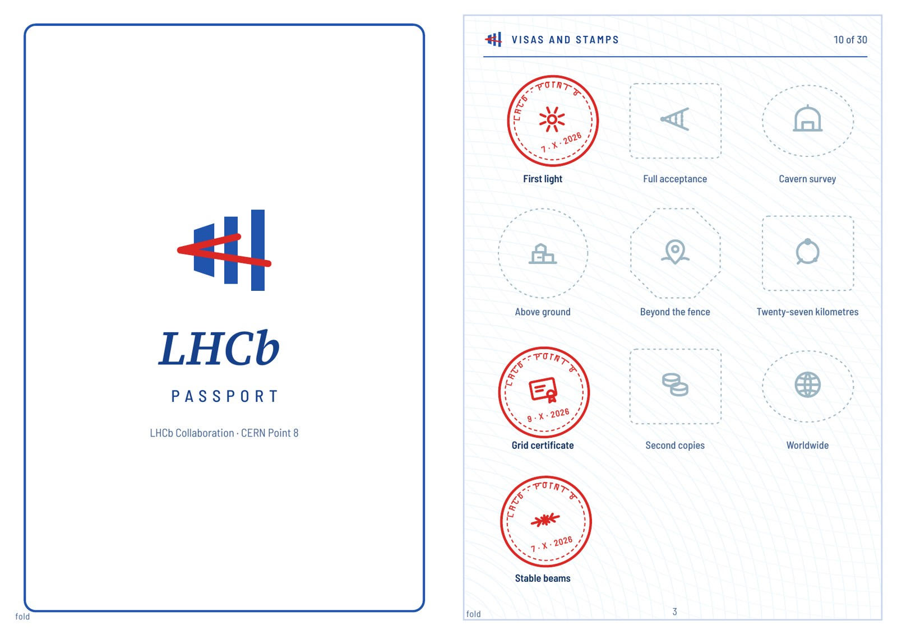
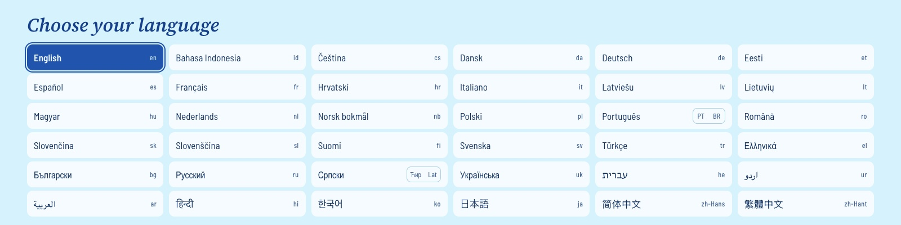
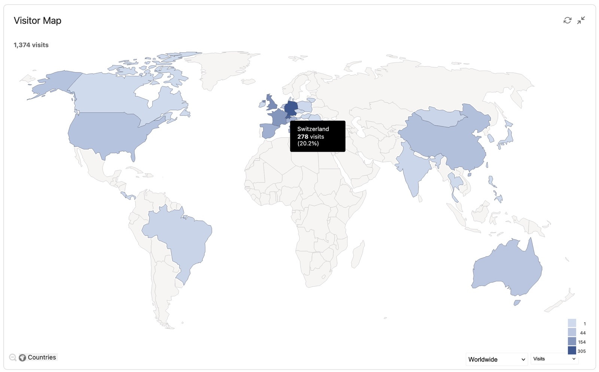

<style>
/* Deck-local: live Explore LHCb embeds. Each .embed box holds a live iframe
   over a screenshot of it. On screen the iframe covers the screenshot; in the
   PDF (print) the iframe is hidden, because Chrome prints it live without its
   backgrounds, so the PDF shows the screenshot instead. */
section .embed {
  position: relative;
  display: block;
  width: 880px;
  height: 495px;
  flex-shrink: 0;
  margin: var(--sp-3) auto 0;
  overflow: hidden;
  border-radius: 12px;
  background: #0d2a5c center / cover no-repeat;
}
section .embed iframe {
  position: absolute;
  inset: 0;
  width: 100%;
  height: 100%;
  border: 0;
}
@media print { section .embed iframe { visibility: hidden; } }
section .embed.sim-ja { background-image: url(assets/embed-sim-ja.jpg); }
/* the live demo: the whole explorer, filling the slide (Marp's nav buttons still sit on top) */
section .embed.demo {
  position: absolute;
  inset: 0;
  z-index: 50;
  width: auto;
  height: auto;
  margin: 0;
  border-radius: 0;
  background-image: url(assets/tour-point8.jpg);
}
section .embed.demo.redecay { background-image: url(assets/sim-redecay.jpg); }
/* Deck-local: full-window explorer screenshots, floating as a card */
section figure.shot {
  position: absolute; left: 50%; top: 54%; transform: translate(-50%, -50%); z-index: 5;
  margin: 0; padding: var(--sp-2); background: var(--paper);
  border: 3px solid var(--ink); border-radius: 20px; box-shadow: 0 28px 70px rgba(74, 23, 137, 0.30);
}
section figure.shot img { display: block; width: 1000px; max-width: none; max-height: none; height: auto; border: none; border-radius: 8px; }
/* Deck-local: three columns of game names */
section .cols.three { grid-template-columns: 1fr 1fr 1fr; align-items: start; }
section .cols.three ul { margin-top: 0.2em; }
section .cols.three p { margin: 0; }
section .cols.ask { grid-template-columns: 1fr 300px; align-items: center; }
section figure.qr img { width: 280px; max-height: none; border: none; image-rendering: pixelated; }
section .cols.passport { grid-template-columns: 1.45fr 1fr; align-items: center; }
</style>

# What is it?

<div class="cols">
<div>

- Fly from the Geneva basin down to the cavern, 100 m underground
- A guided tour, 6 stories, 18 games and a "Toolbox" of statistics concepts
- A passport to collect stamps in
- Web browser based, offline friendly
- Can be "installed" on phones as a PWA

</div>
<div>

<figure>
  <a href="https://explore-lhcb.web.cern.ch/"></a>
  <figcaption><a href="https://explore-lhcb.web.cern.ch/">explore-lhcb.web.cern.ch</a></figcaption>
</figure>

</div>
</div>

---

# Live demo

<div class="embed demo"><iframe src="https://explore-lhcb.web.cern.ch/" title="Explore LHCb" allow="fullscreen"></iframe></div>

<!-- Demo order: tour (first minute) → Explore → Map → a story → Games → passport -->

---

<!-- _class: section -->

# What could we use this for?

---

# Documentation

- Sections can be embedded in any page:

```html
<div data-lhcb-story="sim" data-lang="en"></div>
<script src="https://explore-lhcb.web.cern.ch/embed.js" defer></script>
```

- First user: the [simulation project website](https://lhcb-simulation.web.cern.ch/)
    - Shown at the simulation days
- The Toolbox could help new students too
    - p-values, look-elsewhere, upper limits, blinding, ...
- Could be useful for the Starterkit?

---

# How LHCb simulates a collision

<figure class="shot"></figure>

---

# How LHCb simulates a collision

<figure class="shot"></figure>

---

# How LHCb simulates a collision

<figure class="shot"></figure>

---

# How LHCb simulates a collision

<figure class="shot"></figure>

---

<!-- the act alone, live; the screenshot behind it is what the PDF shows -->
# Simulate the rest once

<div class="embed demo redecay"><iframe loading="lazy" src="https://explore-lhcb.web.cern.ch/?embed=sim&act=fast&only=1&lang=en&play=1" title="How LHCb simulates a collision: Faster still" allow="fullscreen"></iframe></div>

---

# **Two experiments in one:** SMOG2

<figure>
  
  <figcaption>The SMOG2 cell at its true size, just upstream of the VELO: 20 cm long, 1 cm across</figcaption>
</figure>

---

# Games

<div class="cols three">
<div>

**Detector**

- Track fitter
- Out of nowhere
- Vertex hunter
- RICH get richer
- Align the detector
- Build the event

</div>
<div>

**Trigger, operations, computing**

- Be the trigger
- Write HLT1
- HLT operations
- Level the beams
- Ship the data
- Make the sample
- Match-maker

</div>
<div>

**Physics**

- Count the difference
- Pentaquark hunt
- Catch the flip
- Cosmic lab
- Approved!

</div>
</div>

---

<!-- _class: section -->

# Outreach

---

# Outreach: anyone, anywhere

- Works offline on a phone, so it survives a cavern, a classroom or bad Wi-Fi
- Every story and game has a depth: _Start here_, _Go deeper_, _Insider_
- **[Job shadowing](https://voisins.web.cern.ch/en/job-shadowing-internships-cern):** local school students spending a few days at CERN
    - A self-guided way through LHCb, from the surface to an analysis

---

# Outreach: in person

- **Place stamps:** signed QR codes for things you do in person
    - e.g. a Point 8 visit, a masterclass, an open day
    - Still no server: the code carries the signature, the passport stays in the browser
- Leaderboard? Classroom integrations?

---

# CERN Open Days 2027

- **24–26 September 2027**, more than 75,000 visitors last time
- Visitors spend a lot of time queuing with a phone in their hand
    - Before: the tour and the stories, in their own language
    - At Point 8: stamps for what they actually saw
    - After: something to take home and keep playing
- CERN open days from home?

---

# The passport

<div class="cols passport">
<div>

<figure>
  
</figure>

</div>
<div>

- 30 stamps for places, stories and games
    - Some only in person, by scanning a QR code
- Print it as a booklet, or share it
- Move it to another device with a code
- Name and photo never leave the device

</div>
</div>

---

# Languages

<figure>
  
</figure>

- 36 languages (plus Brazilian Portuguese and Latin-script Serbian), including right-to-left
- Everything is translated: tour, stories, games, passport
    - LLM translations: "a few weird bits, but fine enough"

---

# Any language, anywhere

<div class="embed sim-ja"><iframe src="https://explore-lhcb.web.cern.ch/?embed=sim&lang=ja" title="How LHCb simulates a collision, in Japanese" allow="fullscreen"></iframe></div>

---

# Who's using it?

<div class="cols">
<div>

- **1,374 visits** since it was shared in October
    - Average visit: **5 min 10 s**, ~20 actions
    - Bounce rate: 2%
- Most viewed: the tour, then the games
- Germany, Switzerland, UK, France, then everywhere
- Cookieless, no visitor IDs, with an opt-out

</div>
<div>

<figure>
  
  <figcaption>CERN's Matomo, 17 November</figcaption>
</figure>

</div>
</div>

---

# Public results

- **Pentaquark hunt:** real data, with the published fit
- **Idea:** a playable companion when a notable result goes public
    - Making one with an LLM is now cheap

---

# What next?

<figure class="qr">
  
  <figcaption><a href="https://explore-lhcb.web.cern.ch/">explore-lhcb.web.cern.ch</a></figcaption>
</figure>

- [Open an issue with ideas?](https://gitlab.cern.ch/cburr/explore-lhcb/-/issues)

---


<!-- _class: section -->

# Questions?

---

<!-- _class: section -->

# Backup

---

# How it was made

- Mostly sending a couple of messages, then coming back an hour or two later
- My prompts: random ideas and bulleted lists of LHCb facts from memory
    - I guided technical decisions only very broadly

| | Web chats | Laptop | Total |
|---|---:|---:|---:|
| Sessions | 6 | 32 | 38 |
| Messages I typed | ~100 | ~390 | ~490<sup>*</sup> |
| Words I typed | ~1,900 | ~8,000 | ~10,000 |
| Subagents | – | ~610 | ~610 |
| Tool calls | ~770 | ~29,000 | ~30,000<sup>†</sup> |
| Tokens generated | ~0.3 M | ~4.5 M | ~4.8 M |

<div class="footnotes">
  <div class="footnote">* Typically a dozen words each.</div>
  <div class="footnote">† ~3,400 of them file edits.</div>
</div>

---

# Under the hood

- [`three.js`](https://threejs.org/) and vanilla HTML/JS/CSS, no framework
- **Sources:**
    - Detector geometry from the [Phoenix](https://hepsoftwarefoundation.org/phoenix/) event display, with cosmetic fixes
    - Cavern converted and simplified from the CAD model
    - Surface from the photogrammetry on [maps.cern.ch](https://maps.cern.ch/)
    - Facts from the Upgrade I paper, plus many others the LLM found along the way
- Static site on CERN PaaS (nginx), ~40 MB
- Cookieless, anonymous analytics via CERN's Matomo, with an opt-out
