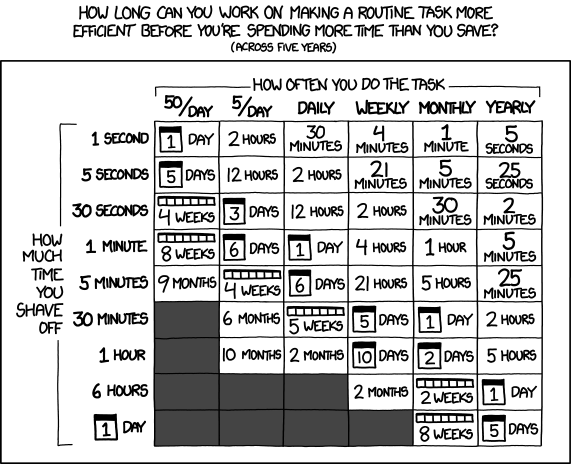
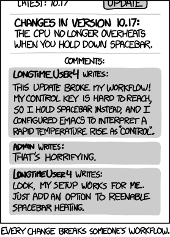

# Disclaimer

- Almost all of this was done by AI agents over a weekend
    - 20+ subagents over ~45 hours
- The code is **not** meant to be merged as it is
- **Aim of today:** decide what we want in Sim10, in Sim11, or not at all

---

# Prototyping is now cheap

- Reviewing isn't as cheap
- Throwing walls of text and code at experts isn't helpful

---

# Prototyping is now cheap

- Trying an idea now costs minutes, not weeks: try everything, measure everything
- For non-experts: **keep asking questions until you understand what is actually going on**
- Throw away the code, keep the numbers
- Use them to decide what we actually want, then implement it properly, in reviewable chunks
- My current best idea of how to use these tools on big long-lived codebases

<svg class="dg" viewBox="0 0 1100 200" role="img" aria-label="Prototype everything, measure it, discuss here, then implement properly in reviewable chunks">
<defs><marker id="ah" viewBox="0 0 10 10" refX="9" refY="5" markerWidth="7" markerHeight="7" orient="auto-start-reverse"><path d="M0 0 L10 5 L0 10 z" fill="#4A1789"/></marker></defs>
<g font-size="24" text-anchor="middle">
<rect x="10" y="40" width="230" height="100" rx="14" fill="#F4F1FA" stroke="#6A3FA8" stroke-width="2" stroke-dasharray="7 5"/>
<text x="125" y="85" font-weight="700" fill="#4A1789">Prototype</text><text x="125" y="115" font-size="18" fill="#6C7280">everything, cheaply</text>
<rect x="290" y="40" width="230" height="100" rx="14" fill="#fff" stroke="#4A1789" stroke-width="3"/>
<text x="405" y="85" font-weight="700" fill="#4A1789">Measure</text><text x="405" y="115" font-size="18" fill="#6C7280">paired, validated</text>
<rect x="570" y="40" width="230" height="100" rx="14" fill="#4A1789"/>
<text x="685" y="85" font-weight="700" fill="#fff">Discuss</text><text x="685" y="115" font-size="18" fill="#E9DFF7">← we are here</text>
<rect x="850" y="40" width="240" height="100" rx="14" fill="#fff" stroke="#1F9D55" stroke-width="3"/>
<text x="970" y="85" font-weight="700" fill="#1F9D55">Implement</text><text x="970" y="115" font-size="18" fill="#6C7280">properly, reviewably</text>
<path d="M242 90 L284 90" stroke="#4A1789" stroke-width="3" marker-end="url(#ah)"/>
<path d="M522 90 L564 90" stroke="#4A1789" stroke-width="3" marker-end="url(#ah)"/>
<path d="M802 90 L844 90" stroke="#4A1789" stroke-width="3" marker-end="url(#ah)"/>
<text x="125" y="185" font-size="18" fill="#D6332B">then throw it away</text>
</g>
</svg>

---

# The (initial) prompts*

> Let's check out sim10 and see if you can find any optimisations. _Randomly chosen stage 6 file_

<!-- -->

> If we were to get something like a factor of two, that would be amazing

  
* I don't think showing prompts is particularly insightful. The only "trick" was giving it an ambitious target, knowing what to ask for, and nudging the direction with later prompts

---

# The test job

- A real request: Bs → χc0φ for BnoC, [mc-requests!2398](https://gitlab.cern.ch/lhcb-simulation/mc-requests/-/merge_requests/2398) ([pipeline](https://gitlab.cern.ch/lhcb-simulation/mc-requests/-/pipelines/15879736))
- **Sim10h:** Gauss v57r1, Pythia8 + EvtGen, Geant4 10.6 (`FTFP_BERT` EmOpt2)
- **Event type 13134050:** full simulation, 4 spillover slots at 25 ns
- **Conditions:** `Beam6800GeV-2024.W32.34-MagUp-Nu6.3-25ns-Pythia8`
    - DDDB `2024-v00.04`, CondDB `sim10-2024.W32.34-v00.00-mu100`
- **Then:** Boole → HLT1 → HLT2 → Sprucing → merge
- Nightly branches measured against Gauss v58r0, ReDecay also checked with 11574021

---

<!-- _class: section -->

# Where does the time go?

---

# Where the time goes

<svg class="dg" viewBox="0 0 1100 170" role="img" aria-label="Vanilla Gauss per event: generation 10 s, main slot Geant4 32 s, four spillover slots 86 s">
<g font-size="20" text-anchor="middle">
<rect x="0" y="20" width="86" height="70" fill="#B9A2E0"/>
<rect x="86" y="20" width="275" height="70" fill="#4A1789"/>
<rect x="361" y="20" width="186" height="70" fill="#6A3FA8"/>
<rect x="547" y="20" width="183" height="70" fill="#6A3FA8" opacity="0.85"/>
<rect x="730" y="20" width="172" height="70" fill="#6A3FA8" opacity="0.7"/>
<rect x="902" y="20" width="198" height="70" fill="#6A3FA8" opacity="0.55"/>
<text x="223" y="63" fill="#fff" font-weight="700">Main slot 32 s</text>
<text x="454" y="63" fill="#fff">PrevPrev 22 s</text>
<text x="638" y="63" fill="#fff">Prev 21 s</text>
<text x="816" y="63" fill="#fff">Next 20 s</text>
<text x="1001" y="63" fill="#fff">NextNext 23 s</text>
<text x="43" y="120" fill="#4A1789">Gen 10 s</text>
<path d="M361 105 L1100 105" stroke="#D6332B" stroke-width="3"/>
<text x="730" y="140" fill="#D6332B" font-weight="700">Spillover: two-thirds of the event loop</text>
</g>
</svg>

- Vanilla Sim10 (2024, 4 spillover slots): **127 s/evt** + 4 min initialisation
    - Gauss is ~98% of the production chain, everything after it is noise
- Flat profile: **Ranlux 18–20%**, Geant4 navigation ~11%, LHAPDF ~7%
- Geant4 by track: EM showers in the calorimeters ~35%, neutrons ~12%, e± loopers in the magnet ~11%, RICH photons ~8%

---

# Headline numbers

| Speed-up vs vanilla | Per event | ReDecay, per event |
|---|---|---|
| Output-identical only | ×1.13 | ×1.31 |
| + statistically equivalent | ×1.71 | ×1.64 |
| + physics approximations | **×2.19** | ×1.67 |
| Research setup* | ×2.36 (×2.7 per job) | ×2.0 (×2.7 per 200-evt job) |

- Top three rows: one branch per change in the Sim10 nightly slot, no patched externals
- ReDecay gains less from physics changes: spillover is shared over 100 redecays

  
* Patched LCG Pythia8, PGO+LTO Geant4, vs v57r1

---

# Where LHCb's production CPU goes

| Share of CPU | Full | ReDecay | Other* | Total |
|---|---|---|---|---|
| Run 1 sim | 0.2% | 0.0% | 0.1% | 0.3% |
| Run 2 sim | 9.1% | 2.0% | 0.2% | 11.3% |
| Run 3 sim | **68.2%** | 6.7% | 7.4% | **82.3%** |
| Other sim† | 1.1% | – | 0.0% | 1.1% |
| Not simulation‡ | – | – | 5.1% | 5.1% |
| **Total** | 78.5% | 8.7% | 12.8% | 3.1M HS23-years |

- From the [production activity data](https://lhcbdirac.s3.cern.ch/production-activity/v2/llms.txt): last 12 months, every step of every production
- **tldr:** speeding up Run 3 full simulation is what matters

  
* Mostly SplitSim (7.6%), plus particle guns. † Dev and Upgrade samples. ‡ Sprucing, merging, … (user jobs aren't in the Bookkeeping)

---

# What would it mean for LHCb?

- From the [production activity data](https://lhcbdirac.s3.cern.ch/production-activity/v2/llms.txt) (last 12 months, Bookkeeping):
    - Sim10 Gauss is **202k core-years/yr**, 87% of LHCb production CPU*

| Level | Saved, core-years/yr | % of Sim10 Gauss |
|---|---|---|
| Output-identical | 22,500 | 11% |
| + statistically equivalent | 80,800 | 40% |
| + physics approximations | 105,600 | 52% |

- **Caveat:** one event type and one campaign, extrapolated to all of Sim10

  
* Upper bound: user jobs aren't in the Bookkeeping

---

<!-- _class: section -->

# Initialisation

---

<!-- _class: build card -->

# Initialisation: 4 min → 21 s

- **Pythia8 MPI init:** 5 instances × 36 s
    - Cache to disk, share between slots, skip the zero cross-section CD init
    - Needs an LCG rebuild
- **DetDesc XML + GaussGeo:** 60 s → 13 s
- **Geant4 first-event setup:** 20 s → 7 s
- Only ~1.8% of Sim10 CPU
    - 1.8% of Sim10 CPU!!!
    - Up to ~10% for ReDecay and SplitSim
    - Intangible: user/dev efficiency

<a href="https://xkcd.com/1205/">xkcd 1205</a>

<!-- step -->

<strong>Pythia8 MPI init:</strong> the same answer, five times per job, every job

<svg class="dg" viewBox="0 0 1100 230" role="img" aria-label="Each of the five Pythia instances (main and four spillover slots) runs the same 36 second MPI initialisation; the fix initialises once, shares it with the spillover slots and caches it on disk">
<defs><marker id="ahm" viewBox="0 0 10 10" refX="9" refY="5" markerWidth="7" markerHeight="7" orient="auto-start-reverse"><path d="M0 0 L10 5 L0 10 z" fill="#1F9D55"/></marker></defs>
<g font-size="18" text-anchor="middle">
<text x="270" y="28" font-weight="700" fill="#D6332B">Before: every instance, every job</text>
<g fill="#F4F1FA" stroke="#D6332B" stroke-width="2">
<rect x="20" y="50" width="92" height="70" rx="8"/><rect x="122" y="50" width="92" height="70" rx="8"/><rect x="224" y="50" width="92" height="70" rx="8"/><rect x="326" y="50" width="92" height="70" rx="8"/><rect x="428" y="50" width="92" height="70" rx="8"/>
</g>
<g fill="#4A1789"><text x="66" y="80" font-weight="700">Main</text><text x="168" y="80">PrevPrev</text><text x="270" y="80">Prev</text><text x="372" y="80">Next</text><text x="474" y="80">NextNext</text></g>
<g fill="#D6332B" font-size="16"><text x="66" y="106">36 s</text><text x="168" y="106">36 s</text><text x="270" y="106">36 s</text><text x="372" y="106">36 s</text><text x="474" y="106">36 s</text></g>
<text x="270" y="168" fill="#4A1789">Same settings, so the same integrals: ~3 min per job</text>
<text x="270" y="196" font-size="16" fill="#6C7280">almost all in MultipartonInteractions::init → jetCrossSection</text>
<line x1="560" y1="20" x2="560" y2="215" stroke="#E4E6EB" stroke-width="2"/>
<text x="830" y="28" font-weight="700" fill="#1F9D55">After: once, then shared and cached</text>
<rect x="600" y="50" width="120" height="70" rx="8" fill="#4A1789"/><text x="660" y="80" fill="#fff" font-weight="700">Main</text><text x="660" y="106" fill="#E9DFF7" font-size="16">init once</text>
<path d="M722 85 L782 85" stroke="#1F9D55" stroke-width="2.5" marker-end="url(#ahm)"/>
<rect x="786" y="50" width="160" height="70" rx="8" fill="#fff" stroke="#1F9D55" stroke-width="2"/><text x="866" y="80" fill="#4A1789">4 spillover slots</text><text x="866" y="106" fill="#1F9D55" font-size="16">reuse the state</text>
<rect x="960" y="50" width="130" height="70" rx="8" fill="#fff" stroke="#1F9D55" stroke-width="2" stroke-dasharray="6 4"/><text x="1025" y="80" fill="#4A1789">disk cache</text><text x="1025" y="106" fill="#1F9D55" font-size="16">0.4 MB</text>
<text x="830" y="168" fill="#4A1789">185 s → 37 s shared → 1 s cached</text>
<text x="830" y="196" font-size="16" fill="#6C7280">main slot bit-identical</text>
</g>
</svg>

- **Also:** our tune makes the central-diffraction cross-section zero, but Pythia 8.244 still initialises it: ~¾ of each init. Pythia 8.313 skips it
- Needs a patch to Pythia to support caching
- Should we use a data package to cache these?

<!-- step -->

<strong>DetDesc XML + GaussGeo:</strong> searching everything, every time

| Where | What it did | Saved |
|---|---|---|
| DetDesc XML converter | re-searched the whole document for macros, for every object | 27 s |
| GaussGeo alignment | walked the whole detector-element tree for every volume | 10 s |
| GitEntityResolver | libgit2 doesn't cache trees over 4 kB | 4 s |
| GaussGeo `findPVolume` | linear search for each of 15,864 surfaces | 2 s |

- Mostly the same pattern: a search inside a loop. Build an index once instead
- Output identical. The RICH PMT conditions alone were 18 s of the XML converter

<!-- step -->

<strong>Geant4 first-event setup:</strong> a scan that scales badly with our geometry

<svg class="dg" viewBox="0 0 1100 250" role="img" aria-label="Geant4 scans every placement, so a volume placed thousands of times is scanned thousands of times; the fix visits each logical volume once">
<g font-size="20" text-anchor="middle">
<text x="270" y="28" font-weight="700" fill="#D6332B">Before: every placement</text>
<rect x="210" y="45" width="120" height="44" rx="8" fill="#4A1789"/><text x="270" y="74" fill="#fff" font-weight="700">World</text>
<g fill="#F4F1FA" stroke="#6A3FA8" stroke-width="1.5">
<rect x="20" y="140" width="60" height="34" rx="6"/><rect x="90" y="140" width="60" height="34" rx="6"/><rect x="160" y="140" width="60" height="34" rx="6"/><rect x="230" y="140" width="60" height="34" rx="6"/><rect x="300" y="140" width="60" height="34" rx="6"/><rect x="370" y="140" width="60" height="34" rx="6"/><rect x="440" y="140" width="60" height="34" rx="6"/>
</g>
<g fill="#4A1789" font-size="15"><text x="50" y="162">UT</text><text x="120" y="162">UT</text><text x="190" y="162">UT</text><text x="260" y="162">UT</text><text x="330" y="162">UT</text><text x="400" y="162">UT</text><text x="470" y="162">…</text></g>
<g stroke="#D6332B" stroke-width="1.5"><path d="M270 89 L50 138"/><path d="M270 89 L120 138"/><path d="M270 89 L190 138"/><path d="M270 89 L260 138"/><path d="M270 89 L330 138"/><path d="M270 89 L400 138"/><path d="M270 89 L470 138"/></g>
<text x="270" y="210" fill="#4A1789">~12,800 direct daughters of World, ~12,300 of them UT pieces</text>
<text x="270" y="238" font-size="17" fill="#6C7280">each one scanned again, with everything inside it</text>
<line x1="560" y1="20" x2="560" y2="240" stroke="#E4E6EB" stroke-width="2"/>
<text x="830" y="28" font-weight="700" fill="#1F9D55">After: each logical volume once</text>
<rect x="770" y="45" width="120" height="44" rx="8" fill="#4A1789"/><text x="830" y="74" fill="#fff" font-weight="700">World</text>
<rect x="760" y="140" width="140" height="34" rx="6" fill="#F4F1FA" stroke="#1F9D55" stroke-width="2"/><text x="830" y="163" fill="#4A1789" font-size="17">UT piece × 1</text>
<path d="M830 89 L830 138" stroke="#1F9D55" stroke-width="2"/>
<text x="830" y="210" fill="#4A1789">Same couples table, same physics tables</text>
<text x="830" y="238" font-size="17" fill="#6C7280">13 of the 20 s gone, output identical</text>
</g>
</svg>

- On the first event, Geant4 collects every (material, production cut) pair by walking the **placement** tree
- GaussGeo flattens assemblies into World, so that walk is huge.
- Still the same in Geant4 11.4 so worth upstreaming

---

<!-- _class: section -->

# The event loop

---

# Three tiers of changes

- **Output-identical:** byte-identical SIM output
    - Purely technical, no physics sign-off needed
- **Statistically equivalent:** different events, same distributions
    - A bit less trivial to review
- **Physics approximations:** deliberately simulate less
    - Needs more validation

---

<!-- _class: build card -->

# **Output-identical:** ×1.13 for free

- **Geant4 build:** `-Bsymbolic-functions`, `-fno-plt`: −6% of Geant4 time
- **Geant4 geometry:** N-deep subtraction chains were O(N²)
    - The magnet coil alone was ~5% of stepping
- **Small stuff:**
    - Bertini/GEM memoisation
    - direct field-map lookup
    - RICH G4 histograms off
- **Generation:**
    - LHAPDF evaluates all flavours in one pass
    - Pile-up that can never be the signal isn't converted to HepMC
- **ReDecay:** packing checks only on newly simulated events (−17%)

<!-- step -->

<strong>LHAPDF:</strong> ten flavours, the same work ten times

<svg class="dg" viewBox="0 0 1100 240" role="img" aria-label="Pythia's LHAPDF6 plugin called xfxQ2 once per flavour, each call redoing the knot search, logarithms and derivatives; the new plugin does the shared work once per point and only the per-flavour interpolation ten times">
<defs><marker id="ahl" viewBox="0 0 10 10" refX="9" refY="5" markerWidth="7" markerHeight="7" orient="auto-start-reverse"><path d="M0 0 L10 5 L0 10 z" fill="#1F9D55"/></marker></defs>
<g font-size="17" text-anchor="middle">
<text x="270" y="26" font-weight="700" fill="#D6332B" font-size="19">Before: one xfxQ2 call per flavour</text>
<g fill="#F4F1FA" stroke="#D6332B" stroke-width="1.5">
<rect x="20" y="42" width="500" height="34" rx="6"/><rect x="20" y="82" width="500" height="34" rx="6"/><rect x="20" y="122" width="500" height="34" rx="6"/>
</g>
<g fill="#4A1789"><text x="270" y="65">g: find knots · logs · derivatives · interpolate</text><text x="270" y="105">d: find knots · logs · derivatives · interpolate</text><text x="270" y="145">u: find knots · logs · derivatives · interpolate</text></g>
<text x="270" y="176" fill="#D6332B">… × 10 flavours, 1463 ns per point</text>
<text x="270" y="210" fill="#6C7280" font-size="16">33% of generation time</text>
<line x1="560" y1="15" x2="560" y2="225" stroke="#E4E6EB" stroke-width="2"/>
<text x="830" y="26" font-weight="700" fill="#1F9D55" font-size="19">After: shared work once per point</text>
<rect x="600" y="42" width="460" height="40" rx="8" fill="#4A1789"/><text x="830" y="68" fill="#fff" font-weight="700">find knots · logs · derivatives</text>
<g stroke="#1F9D55" stroke-width="2"><path d="M650 84 L650 116" marker-end="url(#ahl)"/><path d="M740 84 L740 116" marker-end="url(#ahl)"/><path d="M830 84 L830 116" marker-end="url(#ahl)"/><path d="M920 84 L920 116" marker-end="url(#ahl)"/><path d="M1010 84 L1010 116" marker-end="url(#ahl)"/></g>
<g fill="#fff" stroke="#1F9D55" stroke-width="1.5"><rect x="615" y="120" width="70" height="36" rx="6"/><rect x="705" y="120" width="70" height="36" rx="6"/><rect x="795" y="120" width="70" height="36" rx="6"/><rect x="885" y="120" width="70" height="36" rx="6"/><rect x="975" y="120" width="70" height="36" rx="6"/></g>
<g fill="#4A1789" font-size="15"><text x="650" y="143">interp g</text><text x="740" y="143">interp d</text><text x="830" y="143">interp u</text><text x="920" y="143">…</text><text x="1010" y="143">interp b</text></g>
<text x="830" y="176" fill="#1F9D55">170 ns per point</text>
<text x="830" y="210" fill="#6C7280" font-size="16">each flavour: exactly the same floating-point operations</text>
</g>
</svg>

- Pythia's LHAPDF6 plugin asked for each parton flavour separately => duplicated work
- **Generation −31%** (7.2 → 4.9 s/evt), init −22 s, bitwise identical
- Should be fixed in LHAPDF, could be patched in Gauss for Sim10 if preferred

---

# **Statistically equivalent:** ×1.71

- **RNG:** Ranlux (76 ns/number) → MixMax (2.4 ns), Gaussino's default
    - **An aside:** MTwist was tried in 2015 and reverted, why? The bug on a later slide?
- **RICH:** only call Cherenkov/scintillation where they can act
    - They were force-called on every charged step, in every material
- **RICH:** QE preselection at photon production
- **Geant4:** gamma general process, world voxel tuning

  
Validated item by item: 320–640 paired events each, Hotelling T² over 7 detectors, no coherent deficit

---

# **Physics approximations:** ×2.19

- **Looper kill:** e± in the world volume after 50 ns
    - Removes only late hits; prompt hits, digits and raw banks unchanged
    - Prev slot needs ≥ 100 ns, it lands in the current crossing's window
- **Spillover kill:** e±/γ created in ECAL in PrevPrev, Next and NextNext
    - The calorimeters only read Prev- These need a decision, not just a validation

---

# **Spillover:** two-thirds of the time, for what?

- Each spillover slot is a full minimum-bias Geant4 event
- What actually reads them:
    - **Calo:** Prev only (undocumented, probably legacy)
    - **VP:** spillover off, it gave too many ghosts
    - **RICH:** every slot, even though AppConfig asks it not to (since ≥ 2013)
- Fixing the RICH override would save another ~20 s/evt
- **Question:** what should spillover look like in Sim11?

---

# Possible bugs found along the way

- **RICH:** the no-spillover digitisation option silently does nothing
- **RICH:** spillover veto drops in-time signal, has a Next veto(?)
- **CLHEP:** MTwist doesn't reset on reseed
- **ReDecay, RICH:** output ordered by heap address
- **Pythia:** junctions are lost when hadronising the main slot

<a href="https://xkcd.com/1172/">xkcd 1172</a>

---

# **Pythia:** junctions lost in hadronisation

<svg class="dg" viewBox="0 0 1100 200" role="img" aria-label="Spillover slots use Pythia next, which keeps the junctions. The main slot generates partons and then calls forceHadronLevel, which rebuilds junctions from colour tags and fails for 14% of junction events, leaving the interaction empty">
<defs><marker id="ahp" viewBox="0 0 10 10" refX="9" refY="5" markerWidth="7" markerHeight="7" orient="auto-start-reverse"><path d="M0 0 L10 5 L0 10 z" fill="#4A1789"/></marker></defs>
<g font-size="19" text-anchor="middle">
<text x="80" y="58" font-weight="700" fill="#4A1789">Spillover</text>
<rect x="170" y="25" width="240" height="56" rx="10" fill="#fff" stroke="#4A1789" stroke-width="2"/><text x="290" y="59" fill="#4A1789"><tspan font-family="Fira Mono, monospace" font-size="17">Pythia::next()</tspan></text>
<path d="M412 53 L466 53" stroke="#4A1789" stroke-width="2.5" marker-end="url(#ahp)"/>
<rect x="470" y="25" width="370" height="56" rx="10" fill="#fff" stroke="#4A1789" stroke-width="2"/><text x="655" y="59" fill="#4A1789">hadronise with Pythia's own junctions</text>
<path d="M842 53 L896 53" stroke="#4A1789" stroke-width="2.5" marker-end="url(#ahp)"/>
<text x="975" y="60" font-weight="700" fill="#1F9D55">✔ always works</text>
<text x="80" y="153" font-weight="700" fill="#4A1789">Main slot</text>
<rect x="170" y="120" width="240" height="56" rx="10" fill="#fff" stroke="#4A1789" stroke-width="2"/><text x="290" y="154" fill="#4A1789"><tspan font-family="Fira Mono, monospace" font-size="17">partonLevel()</tspan></text>
<path d="M412 148 L466 148" stroke="#4A1789" stroke-width="2.5" marker-end="url(#ahp)"/>
<rect x="470" y="120" width="370" height="56" rx="10" fill="#F4F1FA" stroke="#D6332B" stroke-width="2"/><text x="655" y="145" fill="#4A1789"><tspan font-family="Fira Mono, monospace" font-size="16">forceHadronLevel()</tspan></text><text x="655" y="168" font-size="16" fill="#D6332B">rebuilds junctions from colour tags</text>
<path d="M842 148 L896 148" stroke="#4A1789" stroke-width="2.5" marker-end="url(#ahp)"/>
<text x="1000" y="145" font-weight="700" fill="#D6332B">✘ 14% fail:</text><text x="1000" y="170" font-weight="700" fill="#D6332B">empty interaction</text>
</g>
</svg>

- **Junction:** three colour lines meeting at a point, in ~4% of interactions
- **Why two paths:** the main slot is hadronised separately, to repeat it until the signal appears
- **Effect:** 0.5% of main-slot pile-up interactions are empty
- **Fix:** keep Pythia's junctions: multiplicity +1.5%, signal unchanged

  
The rebuild is meant for external events, which arrive without junctions. Still the same in Pythia 8.318

---

<!-- _class: section -->

# Bit-for-bit reproducibility

---

# It's already happening elsewhere

- [lhcb/LHCb#455](https://gitlab.cern.ch/lhcb/LHCb/-/work_items/455): reducing ref differences across platforms
    - SIMD width independence, exact NEON div/sqrt, portable field-map interpolation
- [lhcb/LHCb#458](https://gitlab.cern.ch/lhcb/LHCb/-/work_items/458): replace Vc in RICH with a fixed-width, portable backend
- [lhcb/Allen#642](https://gitlab.cern.ch/lhcb/Allen/-/work_items/642): make the CPU backend reproduce the GPU
    - VELO validation counters already agree exactly

---

# Why I think it's powerful

- **Platforms:** if x86 and ARM give identical output, there's nothing to validate
- **Technical vs physics:** a technical change must give identical output
    - Checking it is a diff, not a study, so we can optimise freely
- **Physics validation:** paired events show exactly what moved
    - No more "is this a fluctuation?"
    - 1 ulp in the RF foil rotation moves 2,971 placements, then events diverge completely
- **Exposes bugs:** see next slide

---

# **Sim11:** why it isn't reproducible

- **FMA contraction:** gcc fuses `a*b+c` in opt builds, not in dbg
    - Nightly opt vs dbg: 23 of 24 minimum-bias events differ
    - LCG's aarch64 externals are built with FMA, the x86 ones aren't
- **Argument order:** `f(G4UniformRand(), G4UniformRand())`
    - This was the whole gcc vs clang difference
- **libm:** `cbrt` and `hypot` aren't correctly rounded, and differ between x86 and ARM
- **Job history:** EvtGen initialises inside the first event, drawing ~2×10⁵ random numbers from it
    - Event N alone ≠ event N in a job, multithreaded jobs differ run to run

  
lhcb-sim11 nightly: Gauss on Gaussino + Geant4 11.4

---

# **Sim11:** where it stands

| Minimum bias, 2024, default seeds | Identical events |
|---|---|
| gcc opt vs gcc dbg | 24/24 (nightly: 1/24) |
| gcc vs clang | 48/48 |
| 4 threads vs 1 thread | 24/24 |
| x86 vs ARM, particle gun | 10/10, at every Geant4 step |
| x86 vs ARM, minimum bias | **48/48** |

- **Fixes:** `-ffp-contract=off` everywhere, Geant4 argument order, correctly rounded `G4Cbrt`/`G4Hypot` ([CORE-MATH](https://core-math.gitlabpages.inria.fr/)), fixed-seed EvtGen initialisation
- **Cost of `-ffp-contract=off`:** basically nothing
    - x86: +0.13 ± 0.23% per Geant4 step (576 paired events)
    - ARM: ~2% per Geant4 step, not visible in total job time

  
Per-event md5 of every TES object in the .sim. All fixes are local branches, nothing pushed yet

---

<!-- _class: section -->

# Questions?
